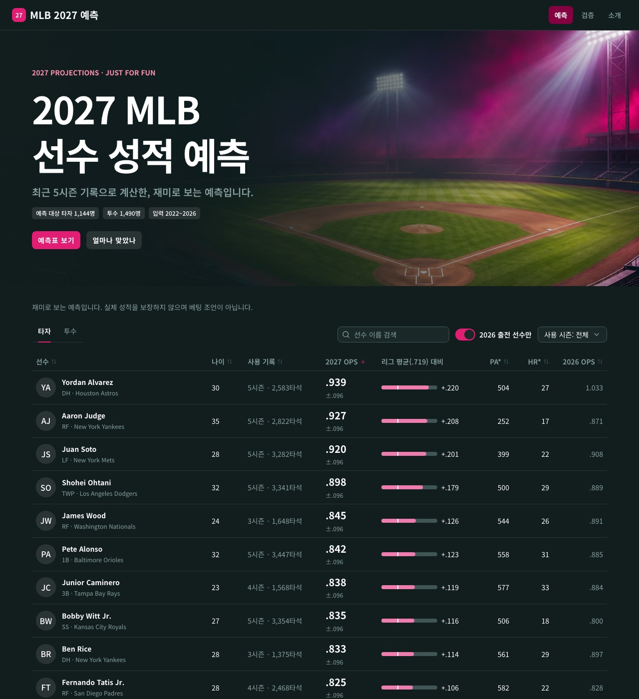
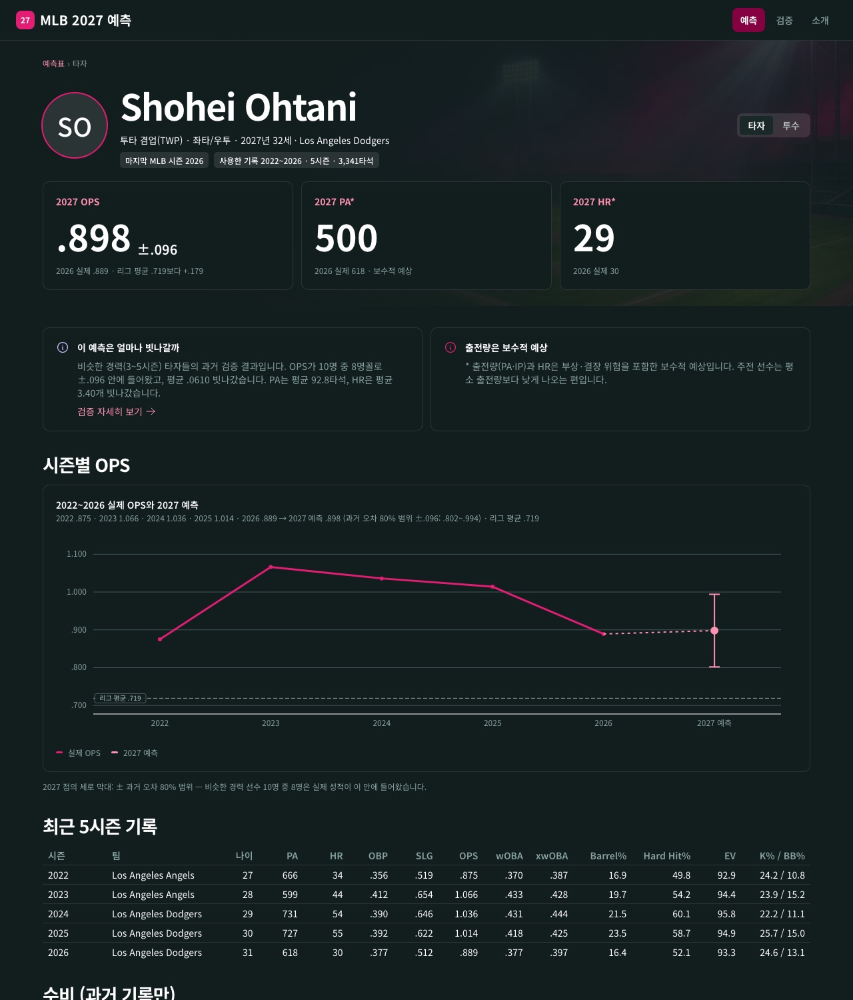
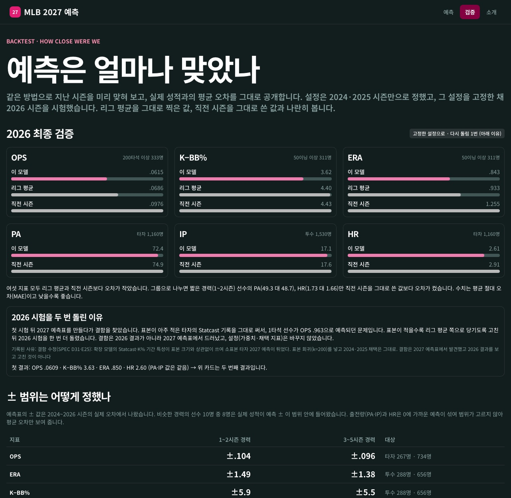
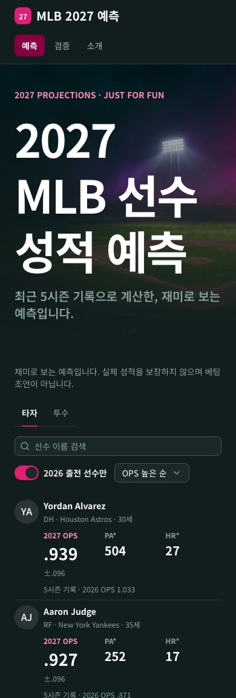
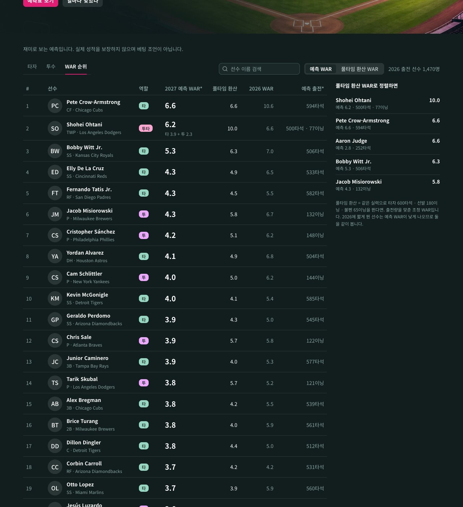
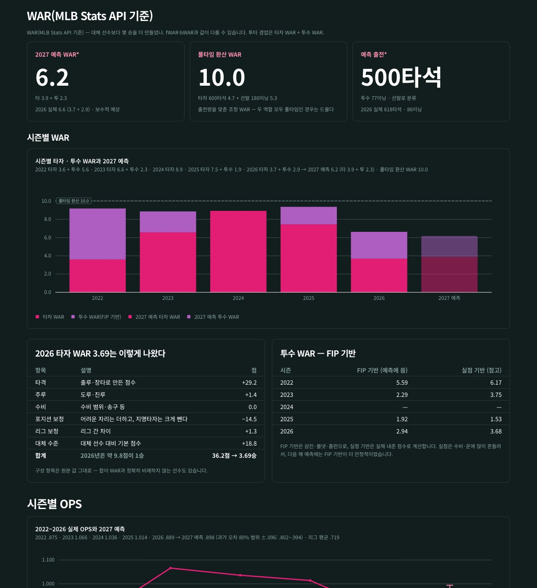
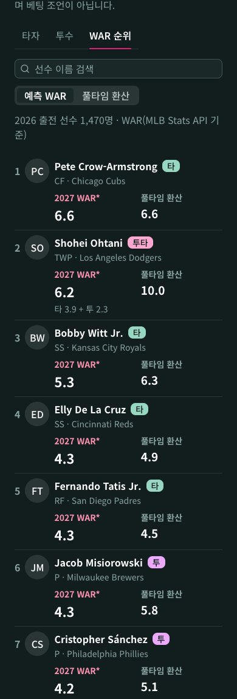

# MLB Player Projections 2027 — just for fun

**English** | [한국어](README_KO.md)

**Live site: https://mlb-projection.vercel.app**

> Fan-made projections for fun. They are not betting advice and come with no guarantee.

Projects the 2027 season for every MLB player who appeared in the last five seasons (2022–2026):

- **Batters**: OPS, plate appearances (PA), home runs (HR)
- **Pitchers**: ERA, innings pitched (IP), K−BB%
- **WAR (v0.5)**: projected WAR and full-time WAR (600 PA · 180 IP as a starter · 65 IP as a reliever) for every player who appeared in 2026. Two-way players get their batting and pitching WAR added into one ranking row

Every projection is shown next to a league-average baseline. The models are also backtested against the 2024, 2025 and 2026 seasons, and those errors are published as they are.

## Status

| Milestone | Scope | Status |
|---|---|---|
| M0–M4 | Setup, collection, cleaning, models, backtests, 2027 projections | done |
| M5–M6 | Design (theme, mockups) and web app | done |
| M7 | Deployment | done — https://mlb-projection.vercel.app |
| M8–M10 (v0.5) | WAR: collection, model, one-time 2026 test, ranking and player screens, deployment | done |

## Screenshots

| Projections table | Player detail |
|---|---|
|  |  |

| Backtest | Mobile |
|---|---|
|  |  |

| WAR ranking (v0.5) | Player WAR (v0.5) | Mobile WAR |
|---|---|---|
|  |  |  |

Screenshots are taken with player photos turned off (initials instead); the live site loads official photos from the MLB image server.

## Backtest results

The model parameters and the extended-model choices were fixed using the 2024 and 2025 seasons only. Then the 2026 season was tested once with those frozen settings ([`data/out/final_test_2026.json`](data/out/final_test_2026.json)). Mean absolute error, lower is better:

| Metric | This model | League average | Prior season |
|---|---|---|---|
| OPS (200+ PA) | **.062** | .069 | .098 |
| K−BB% (50+ IP) | **3.62** | 4.40 | 4.43 |
| ERA (50+ IP) | **0.84** | 0.93 | 1.25 |
| PA | **72.4** | — | 74.9 |
| IP | **17.1** | — | 17.6 |
| HR | **2.61** | — | 2.91 |

The 2026 test was run a second time, once, after fixing a defect: small-sample batters' Statcast features were not shrunk toward the league average, so a 1-PA batter was projected at .963 OPS. The defect showed up in the 2027 table, not in the 2026 results. The first run (OPS .061, K−BB% 3.63, ERA 0.85, HR 2.60) is kept in [`data/out/final_test_2026_run1.json`](data/out/final_test_2026_run1.json); the table shows the second run.

### WAR (v0.5)

WAR settings were fixed using 2024 and 2025 only, then 2026 was tested once ([`data/out/final_test_2026_war.json`](data/out/final_test_2026_war.json)). Mean absolute error in wins:

| What | Who | This model | Prior season | League rate |
|---|---|---|---|---|
| Batter projected WAR | all 1,160 | **.457** | .564 | .513 |
| Pitcher projected WAR | all 1,530 | **.310** | .359 | .347 |
| Batter full-time WAR | 128 regulars | **1.48** | 1.74 | 1.50 |
| Pitcher full-time WAR | 62 regulars | **1.08** | 1.24 | 1.53 |
| Batter projected WAR | 115 with actual WAR ≥ 2 | **1.73** | 1.82 | 2.20 |
| Pitcher projected WAR | 81 with actual WAR ≥ 2 | 1.80 | **1.55** | 2.37 |

One cell loses: pitchers with an actual WAR of 2 or more, where the conservative playing time drags the projection down (the same happened in 2024 and 2025). That is why the ranking also shows full-time WAR. Pitcher WAR is the FIP-based value; the runs-allowed value is shown for reference only, because FIP-based WAR was the most stable from one year to the next.

Playing-time projections are conservative: they price in injury and absence risk, so regulars tend to be projected below their usual workload.

Plans and decisions are written up (in Korean) in [`docs/`](docs/): `SPEC.md`, `PLAN.md` and `TASKS.md`.

## Data sources

- [MLB Stats API](https://statsapi.mlb.com): season stats and player info
- [Baseball Savant](https://baseballsavant.mlb.com): Statcast leaderboards, Outs Above Average and Fielding Run Value
- MLB Stats API sabermetrics: WAR and its batting components (v0.5). These values are not the same as FanGraphs fWAR or Baseball-Reference bWAR

MLB data © MLB Advanced Media, L.P. Only individual, non-commercial, non-bulk use is permitted. This repository does not include the raw downloads (`data/raw/` is git-ignored). The small test fixtures (12 players or fewer per file) are listed in [`tests/fixtures/SOURCE.md`](tests/fixtures/SOURCE.md).

## Tech stack

- **Pipeline**: Python 3.13, standard-library HTTP, pandas; tests with pytest, ruff and mypy
- **Web**: Next.js 16 (static export), React 19, TypeScript, Tailwind CSS 4, the [Astryx](https://github.com/meta/astryx) design system; tests with Vitest

## Development

```bash
python3.13 -m venv venv
venv/bin/pip install -r requirements-dev.txt && venv/bin/pip install -e . --no-deps
venv/bin/ruff check . && venv/bin/mypy && venv/bin/pytest

# pipeline (raw data is downloaded on your machine, never committed)
venv/bin/python -m mlbproj collect && venv/bin/python -m mlbproj validate && venv/bin/python -m mlbproj build
venv/bin/python -m mlbproj backtest     # 2024-2025 backtest
venv/bin/python -m mlbproj export       # 2027 projections -> data/out CSV + web JSON

cd web && npm ci && npm run lint && npm test && npm run build
```

### Deployment

The static build is uploaded to Vercel directly; the web JSON (per-player records) is never committed to any repository.

```bash
venv/bin/python -m mlbproj export
VERCEL_TOKEN=... web/scripts/deploy.sh   # lint, tests, build, Astryx doctor, then upload
```

Set `NEXT_PUBLIC_PLAYER_PHOTOS=off` at build time to switch player photos off.

## Structure

```
mlbproj/      pipeline package (contracts, collect, validate, clean, models, export)
contracts/    JSON schema shared by the pipeline and the web app
tests/        pytest suite and fixtures
web/          Next.js static site
docs/         SPEC, PLAN, TASKS (Korean)
```
