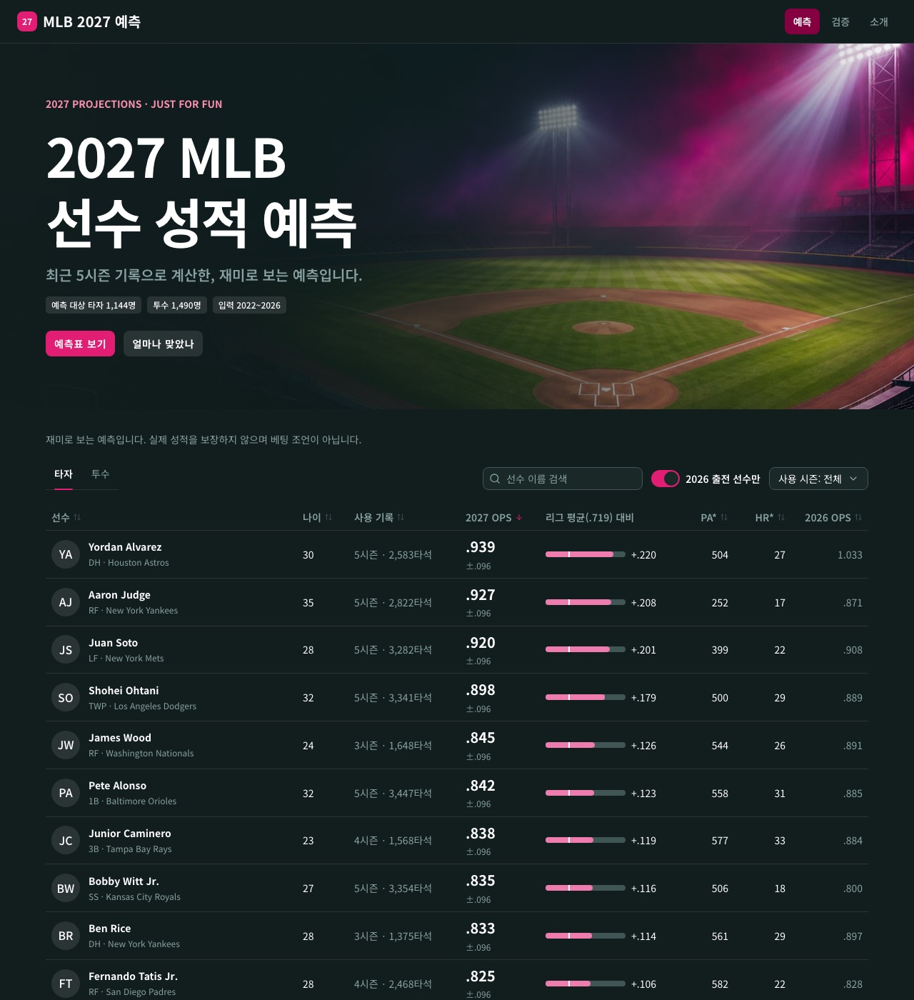
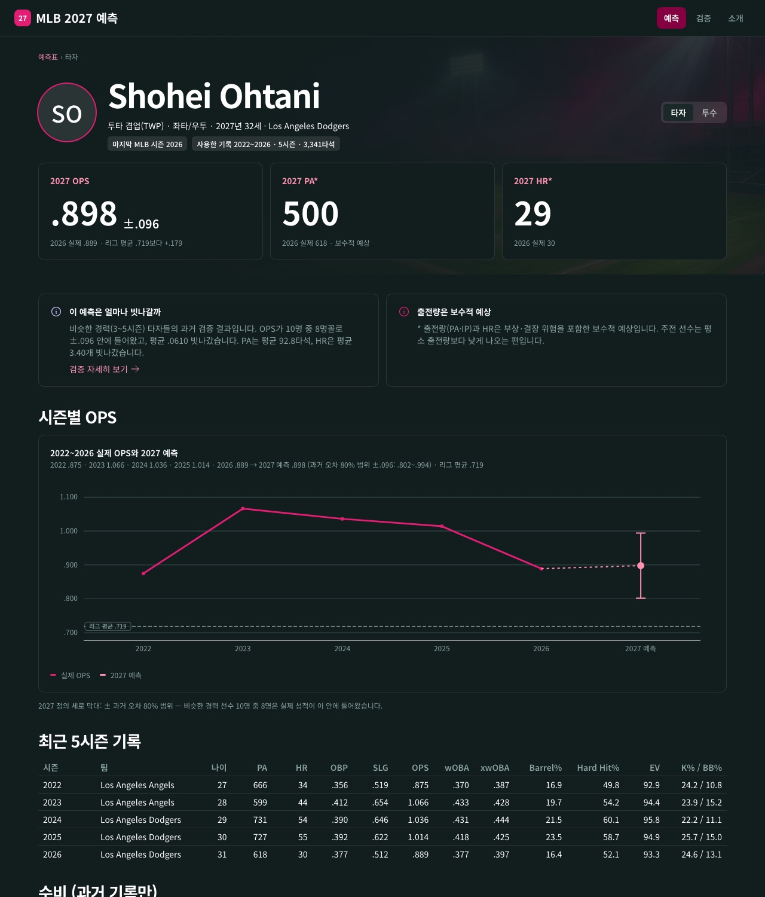
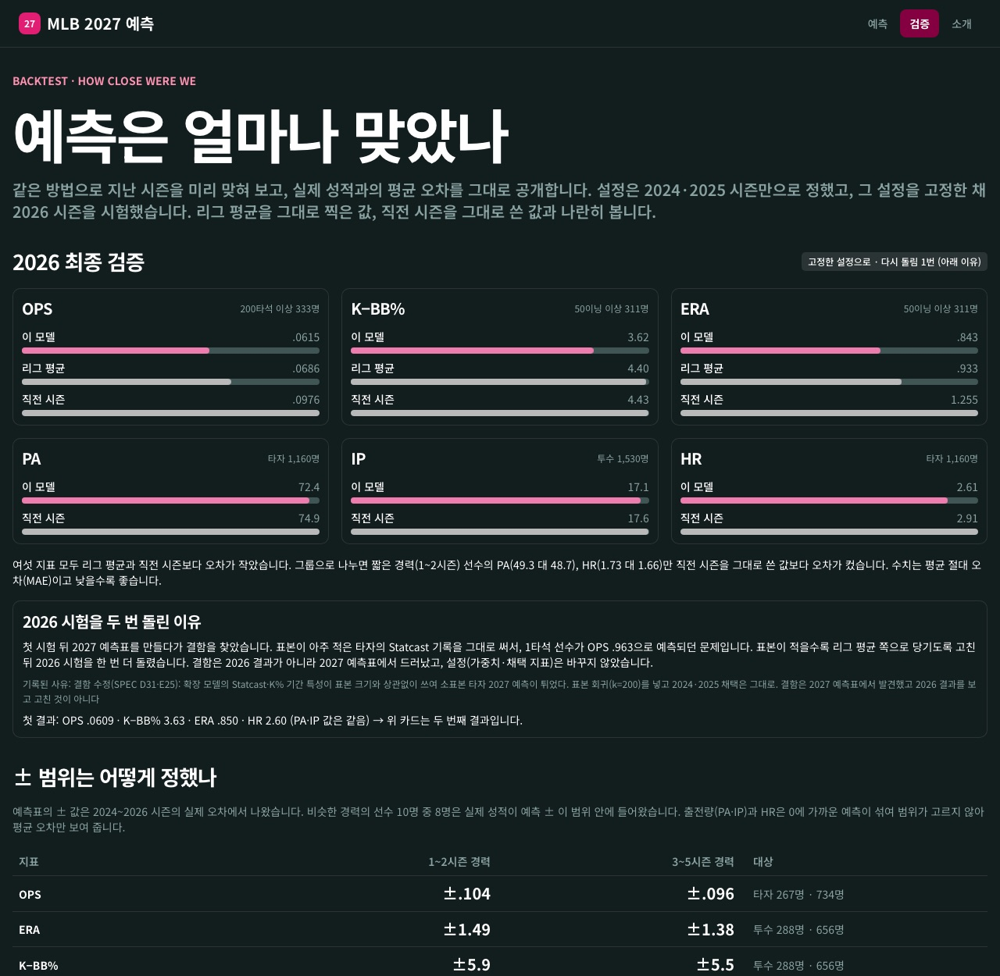
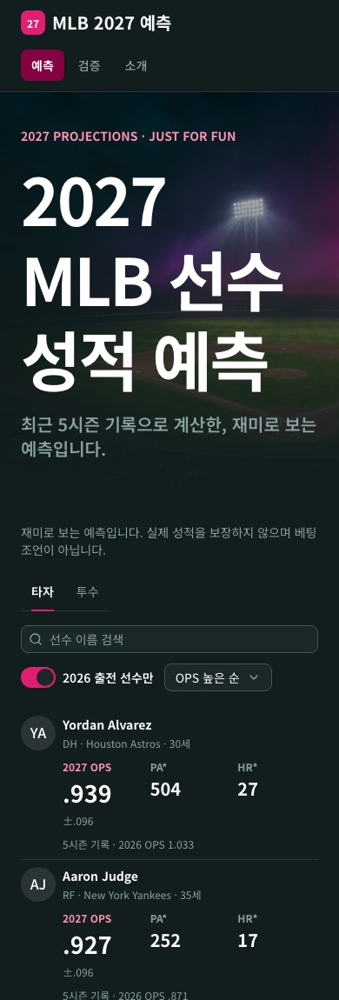
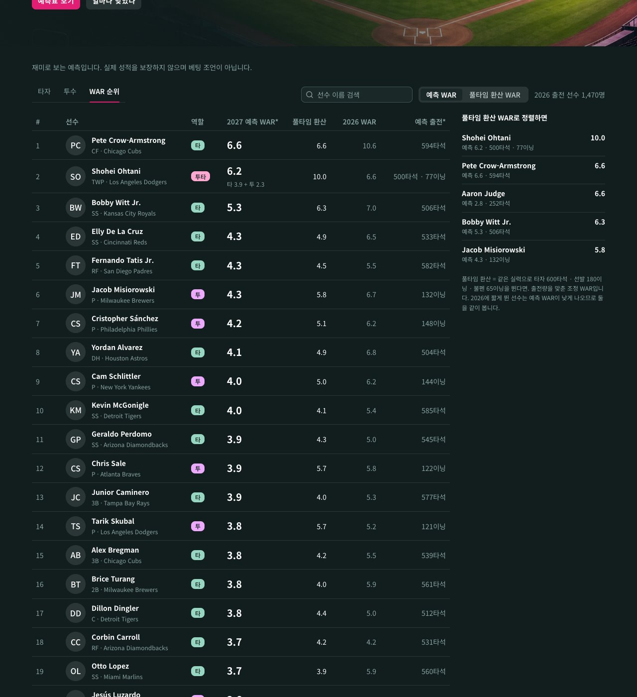
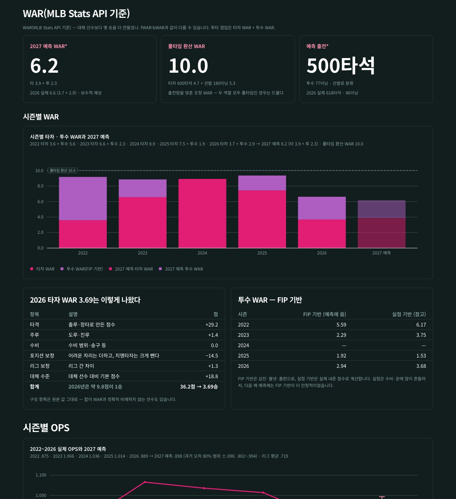
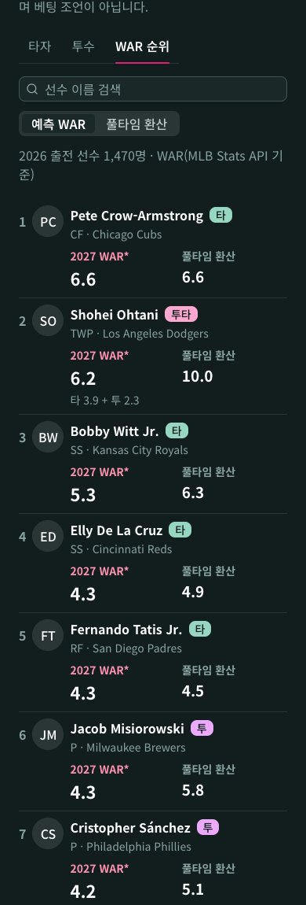

# 재미로 보는 2027 MLB 선수 성적 예측

[English](README.md) | **한국어**

**사이트: https://mlb-projection.vercel.app**

> 재미로 보는 팬 예측이고, 실제 성적을 보장하지 않습니다. 베팅 조언이 아닙니다.

최근 5시즌(2022~2026)에 MLB 기록이 있는 선수 전원의 2027 성적을 예측합니다.

- **타자**: OPS, 타석(PA), 홈런(HR)
- **투수**: ERA, 이닝(IP), K−BB%
- **WAR (v0.5)**: 2026에 뛴 선수 전원의 예측 WAR과 풀타임 환산 WAR(타자 600타석 · 선발 180이닝 · 불펜 65이닝). 투타 겸업 선수는 타자 WAR과 투수 WAR을 더해 한 줄로 순위를 매깁니다

예측값은 언제나 리그 평균 기준선과 나란히 보여 줍니다. 같은 모델로 2024·2025·2026 시즌을 맞혀 보는 과거 검증도 하고, 그 오차를 그대로 공개합니다.

## 진행 상황

| 마일스톤 | 범위 | 상태 |
|---|---|---|
| M0~M4 | 기반 설정, 수집, 정제, 모델, 과거 검증, 2027 예측 | 완료 |
| M5~M6 | 디자인(테마·시안), 웹 | 완료 |
| M7 | 배포 | 완료 — https://mlb-projection.vercel.app |
| M8~M10 (v0.5) | WAR: 수집, 모델, 2026 한 번 시험, 순위·선수 화면, 배포 | 완료 |

## 화면

| 예측표 | 선수 상세 |
|---|---|
|  |  |

| 검증 | 모바일 |
|---|---|
|  |  |

| WAR 순위 (v0.5) | 선수 WAR (v0.5) | 모바일 WAR |
|---|---|---|
|  |  |  |

화면 캡처는 선수 사진을 끈 상태(이니셜)로 찍었습니다. 실제 사이트는 MLB 이미지 서버에서 공식 사진을 불러옵니다.

## 과거 검증 결과

모델 파라미터와 확장 모델 채택은 2024·2025 시즌만으로 정했습니다. 그 설정을 고정한 채 2026 시즌을 한 번만 시험했습니다([`data/out/final_test_2026.json`](data/out/final_test_2026.json)). 평균 절대 오차이며 낮을수록 좋습니다.

| 지표 | 이 모델 | 리그 평균 | 직전 시즌 |
|---|---|---|---|
| OPS (200타석 이상) | **.062** | .069 | .098 |
| K−BB% (50이닝 이상) | **3.62** | 4.40 | 4.43 |
| ERA (50이닝 이상) | **0.84** | 0.93 | 1.25 |
| PA | **72.4** | — | 74.9 |
| IP | **17.1** | — | 17.6 |
| HR | **2.61** | — | 2.91 |

2026 시험은 결함을 고친 뒤 한 번 더 돌렸습니다. 표본이 적은 타자의 Statcast 특성을 리그 평균 쪽으로 당기지 않아서, 1타석 선수가 OPS .963으로 예측되던 문제입니다. 이 결함은 2026 결과가 아니라 2027 예측표에서 드러났습니다. 첫 결과(OPS .061, K−BB% 3.63, ERA 0.85, HR 2.60)는 [`data/out/final_test_2026_run1.json`](data/out/final_test_2026_run1.json)에 그대로 두었고, 표는 두 번째 결과입니다.

### WAR (v0.5)

WAR 설정은 2024·2025 시즌만으로 정하고, 2026 시즌을 한 번만 시험했습니다([`data/out/final_test_2026_war.json`](data/out/final_test_2026_war.json)). 평균 절대 오차(승)입니다.

| 무엇을 | 누구에게 | 이 모델 | 작년 그대로 | 리그 평균 비율 |
|---|---|---|---|---|
| 타자 예측 WAR | 전원 1,160명 | **.457** | .564 | .513 |
| 투수 예측 WAR | 전원 1,530명 | **.310** | .359 | .347 |
| 타자 풀타임 환산 | 주전급 128명 | **1.48** | 1.74 | 1.50 |
| 투수 풀타임 환산 | 주전급 62명 | **1.08** | 1.24 | 1.53 |
| 타자 예측 WAR | 실제 WAR 2 이상 115명 | **1.73** | 1.82 | 2.20 |
| 투수 예측 WAR | 실제 WAR 2 이상 81명 | 1.80 | **1.55** | 2.37 |

진 칸이 하나 있습니다. 실제 WAR 2 이상 투수에서는 출전량을 보수적으로 잡는 약점 때문에 작년 그대로에 졌습니다(2024·2025도 같았습니다). 그래서 순위표에 풀타임 환산 WAR을 같이 둡니다. 투수 WAR은 FIP 기반 값을 쓰고, 실점 기반 값은 참고로만 보여 줍니다. 다음 해 예측에서 FIP 기반이 가장 안정적이었기 때문입니다.

출전량 예측은 보수적입니다. 부상·결장 위험을 평균에 반영하므로 주전 선수는 평소 출전량보다 낮게 예측되는 편입니다.

요구사항·계획·진도는 [`docs/`](docs/)의 `SPEC.md`·`PLAN.md`·`TASKS.md`에 있습니다.

## 데이터 출처

- [MLB Stats API](https://statsapi.mlb.com): 시즌 기록, 선수 정보
- [Baseball Savant](https://baseballsavant.mlb.com): Statcast 리더보드, Outs Above Average, Fielding Run Value
- MLB Stats API 세이버메트릭스: WAR과 타자 WAR 구성 항목(v0.5). FanGraphs fWAR · Baseball-Reference bWAR과 값이 같지 않습니다

MLB 자료의 저작권은 MLB Advanced Media, L.P.에 있으며, 개인적·비상업적·소량 이용만 허용됩니다. 이 저장소에는 원본 데이터를 올리지 않습니다(`data/raw/`는 git 제외). 테스트용 소규모 픽스처(파일당 12명 이하)의 출처는 [`tests/fixtures/SOURCE.md`](tests/fixtures/SOURCE.md)에 적었습니다.

## 기술 스택

- **파이프라인**: Python 3.13, 표준 라이브러리 HTTP, pandas · pytest, ruff, mypy
- **웹**: Next.js 16(정적 export), React 19, TypeScript, Tailwind CSS 4, [Astryx](https://github.com/meta/astryx) 디자인 시스템 · Vitest

## 개발

```bash
python3.13 -m venv venv
venv/bin/pip install -r requirements-dev.txt && venv/bin/pip install -e . --no-deps
venv/bin/ruff check . && venv/bin/mypy && venv/bin/pytest

# 파이프라인 (원본은 각자 내려받고 커밋하지 않습니다)
venv/bin/python -m mlbproj collect && venv/bin/python -m mlbproj validate && venv/bin/python -m mlbproj build
venv/bin/python -m mlbproj backtest     # 2024·2025 과거 검증
venv/bin/python -m mlbproj export       # 2027 예측 → data/out CSV + 웹 JSON

cd web && npm ci && npm run lint && npm test && npm run build
```

### 배포

정적 빌드를 Vercel에 직접 올립니다. 웹 JSON(선수별 기록)은 어느 저장소에도 넣지 않습니다.

```bash
venv/bin/python -m mlbproj export
VERCEL_TOKEN=... web/scripts/deploy.sh   # 린트·테스트·빌드·Astryx 진단 뒤 업로드
```

빌드할 때 `NEXT_PUBLIC_PLAYER_PHOTOS=off`를 주면 선수 사진을 끕니다.

## 구조

```
mlbproj/      파이프라인 패키지 (계약, 수집, 검증, 정제, 모델, 내보내기)
contracts/    파이프라인과 웹이 함께 쓰는 JSON 스키마
tests/        pytest 테스트와 픽스처
web/          Next.js 정적 사이트
docs/         SPEC, PLAN, TASKS
```
