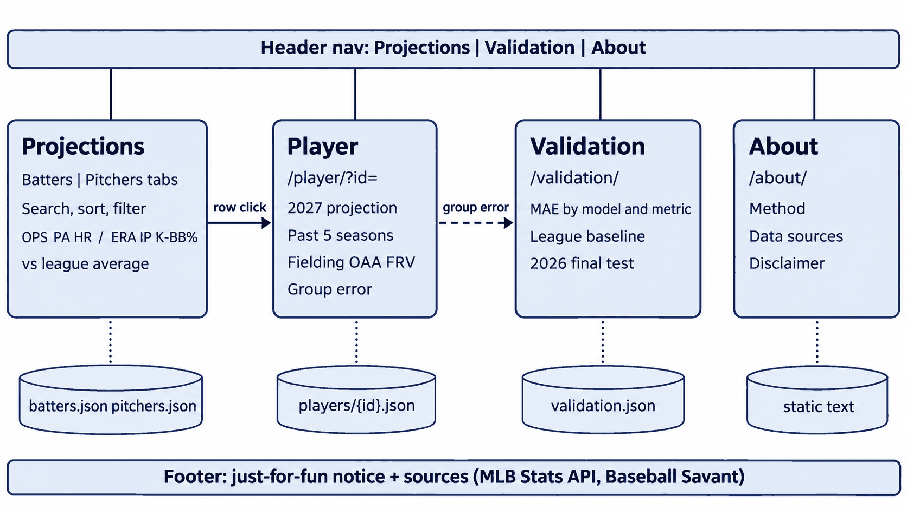

# DESIGN.md — mlb-projection

> **상태: v0.1 초안** (M5 진행 중). 기준은 `docs/SPEC.md` v0.3 · `docs/PLAN.md` v0.2이다. 문서끼리 다르면 SPEC이 기준이다.
> 화면 구현(M6)은 이 문서의 시안 합의(T5-7) 뒤에 시작한다(워크스페이스 UI 디자인 사전 합의 원칙).
> 시안·와이어프레임 캔버스: https://claude.ai/artifact/DNAE9tW2Nydscsc3Dn2WRG (비공개)

---

## 1. 정보 구조 (IA, T5-1)

*그림 1. 사이트 구조. 예측표(`/`)에서 행을 누르면 선수 상세로 가고, 선수 상세의 "이 예측은 얼마나 빗나갈까"에서 검증으로 간다. 모든 페이지가 같은 헤더(예측 · 검증 · 소개)와 푸터(고지·출처, SPEC F16)를 쓴다. 각 페이지는 `contracts/web-data.schema.json`의 파일 하나만 읽는다.*

### 1-1. 페이지

| 페이지 | 주소 | 목적 (SPEC) | 읽는 데이터 | 주요 구성 |
|---|---|---|---|---|
| 예측표 | `/` | 2027 예측을 훑고 찾기 (F13) | `batters.json`, `pitchers.json` (각 1MB 이하, N6) | 히어로(Codex 이미지, D19·D20) · 고지 한 줄 · 타자/투수 탭 · 검색 · 필터(2026 출전 선수만, 사용 시즌 그룹) · 정렬되는 표 · 페이지 나눔 |
| 선수 상세 | `/player/?id={player_id}` (DS1) | 한 선수의 예측과 근거 (F14) | `players/{id}.json` | 공식 사진(D27, 없으면 이니셜 배지) · 이름·포지션·투타·2027 나이·팀 · 마지막 MLB 시즌·"현역 아님"(D23) · 투타 겸업이면 역할 전환(F12) · 2027 예측 카드 3개(리그 평균 대비·2026 대비) · 그룹 과거 오차 · 사용한 기록(기간·시즌 수·누적 표본) · 시즌별 추이 차트(Astryx charts, D26) · 최근 5시즌 표(D14) · 수비 표(OAA·FRV, 포수 세부, D21) |
| 검증 | `/validation/` | 예측이 얼마나 맞았나 (F15) | `validation.json` | 2026 최종 검증 요약(지표 6개 × 모델·리그 평균·직전 시즌) · 목표 시즌·역할·그룹 필터 · 모델별·지표별 MAE 표 · 평가 집단 설명 |
| 소개 | `/about/` | 방법·데이터·한계·고지 | 정적 글 | 방법 3단계 · 섹션 이미지(Codex) · 데이터 출처·기간 · 알아 두실 점(신인 없음, 팀 이동 미반영, 약한 지표) · 고지(MLBAM 권리) |
| 공통 | — | 고지·출처 (F16), 공유 (F17) | — | 헤더 내비 · 푸터(고지 · 출처 · 깃허브) · OG 이미지(첫 화면용 1장, 선수 상세 기본 1장) |

### 1-2. 이동 경로

- 첫 화면 → (검색·필터·정렬) → 행 클릭 → 선수 상세 → "검증 자세히 보기" → 검증.
- 선수 상세의 뒤로 가기는 예측표의 탭·검색·필터·페이지를 그대로 되돌린다(주소의 해시에 상태를 담는다 — M6에서 정함).
- 헤더 내비로 어느 페이지에서나 예측 · 검증 · 소개로 간다.

### 1-3. 결정 사항

| ID | 항목 | 선택지 | 추천 | 상태 |
|---|---|---|---|---|
| DS1 | 선수 상세 주소 | `/player/?id=660271` 한 페이지가 `players/{id}.json`을 읽는다 | 추천안 그대로 (선수마다 정적 페이지면 빌드 결과가 약 2,600쪽) | ✅ 2026-11-24 사용자 결정 |
| DS2 | 첫 화면 기본값 | 타자 탭, 2027 OPS 높은 순 | — | ✅ 기본값 |
| DS3 | 직전 시즌 미출전·"현역 아님" 선수 | "2026 출전 선수만"을 켠 채 시작, 끄면 전원 | 추천안 그대로 | ✅ 2026-11-24 사용자 결정 |
| DS4 | 긴 표 | 페이지당 50행 + 검색 | — | ✅ 기본값 |
| O6 → SPEC D26 | 차트 | **Astryx charts canary** (core·theme·charts를 같은 canary 빌드로 고정) | 추천은 직접 그린 SVG였다 | ✅ 2026-11-24 사용자 결정 |
| O7 → SPEC D27 | 선수 사진 | **MLB 공식 사진**을 MLB 이미지 서버에서 불러온다. "선수 사진 © MLB" 표기, 실패 시 이니셜 배지 | 추천은 이니셜 배지였다 | ✅ 2026-11-24 사용자 결정 |
| DS5 | 히어로·사이트 색 방향 | **C — 짙은 청록 밤하늘 + 자홍·보라 조명**. 강조색은 자홍 계열, 보조는 보라 | 후보 A(남색+청록)·B(검정+주황)·C를 캔버스에서 비교 | ✅ 2026-11-24 사용자 결정 |
---

## 2. 와이어프레임 (T5-2)

캔버스의 6장(회색 상자 = 자리, `[대괄호]` = 데이터 자리, 파랑 = 누를 수 있는 것). 숫자는 지어내지 않는다.

| 장 | 화면 | 캔버스 |
|---|---|---|
| WF-1 | 예측표 (데스크톱) | `#artboard-Main` |
| WF-2 | 선수 상세 (데스크톱) | `#artboard-WF-Player` |
| WF-3 | 검증 (데스크톱) | `#artboard-WF-Validation` |
| WF-4 | 소개 (데스크톱) | `#artboard-WF-About` |
| WF-5 | 예측표 (모바일 390) — 표 대신 카드 목록 | `#artboard-WF-Mobile-Projections` |
| WF-6 | 선수 상세 (모바일 390) — 카드 세로 쌓기, 넓은 표는 옆으로 밀기 | `#artboard-WF-Mobile-Player` |

---

## 3. 테마 (T5-3)

사이트 전용 테마 **ballpark** — Astryx 테마 편집기(`npx astryx experimental theme editor`)로 neutral을 바탕으로 만들었다(D18). 설정은 `web/themes/ballpark/ballpark.settings.json`이 기준이고, 앱은 `web/src/astryx-themes.ts`(생성 파일)로 불러온다. Astryx core·theme-neutral·charts·cli는 같은 canary 빌드 `0.7.18-canary.gfca8508`로 고정했다(D26).

| 설정 | 값 | 이유 |
|---|---|---|
| mode | dark-only | 야간 경기장 히어로(DS5)와 같은 세계. 밝은 모드는 두지 않는다 |
| accent | `#E11D74` (자홍) | 히어로 C의 조명색. 버튼 기본 채움은 이 색 그대로, 링크·강조 글자는 읽히도록 편집기가 밝은 단계(`#ff91b1`)를 쓴다 |
| neutral | `#5B7B79` (청록 기운 회색) | 히어로 C의 짙은 청록 밤하늘. 바탕·카드·테두리가 이 색조를 띤다 |
| info | `#7C3AED` (보라) | 히어로 C의 보조 조명색 |
| vibrancy | 60 | 기본(50)보다 조금 더 선명하게 (D20) |
| corners | small (8px) | 중계 그래픽처럼 각진 느낌 |
| surfaces | outlined | 숫자 표가 많아 그림자보다 1px 테두리가 깔끔하다 |
| buttons | caps | 대문자·굵게·자간 — 중계 화면 느낌 |
| type / headings | display / bold | 큰 숫자·큰 제목 (D20) |
| badges | solid | 상태 배지를 색으로 분명히 |
| font | `'Noto Sans KR', 'Apple SD Gothic Neo', 'Malgun Gothic', system-ui, sans-serif` | 한글. `@fontsource/noto-sans-kr`(OFL, 2026-11-24 사용자 승인)로 사이트가 직접 제공 — 400·500·600·700 |

명도 대비 조정 (N10, 편집기 검사 + 미리보기 그림을 직접 확인)

- 진행 막대: 자홍 채움이 어두운 트랙 위 1.73:1 → 채움을 `#ee7cae`로(3:1 이상).
- 기본 버튼 hover·pressed: 밝아진 채움 위 흰 글자 4.11~4.44:1 → 채움을 `#C8175F`로 고정(약 6.6:1).
- 위험(destructive) 버튼 글자: 4.44:1 → `#FFD2CE`.
- 남은 그림 문제 없음 (`show ballpark --png`, `pictureProblem: none`).

글꼴: `@fontsource/noto-sans-kr` 설치 뒤 `astryx doctor --built out` 30개 항목 모두 통과. 정적 빌드는 글꼴 조각 때문에 약 20MB지만 브라우저는 화면에 나온 글자 범위의 조각만 받는다.

## 4. 시안 (T5-4) — 진행 중

- **디자인 시스템 "ballpark"**: https://claude.ai/artifact/2tNwcjBEVCQWDWwQb5JRbS (비공개) — 테마 CSS의 다크 값 그대로: 색 17 · 글자 스타일 13 · 간격 7 · 모서리 5, 사용 규칙 README, 표지. 캔버스에 설치했다(`project/ds/ballpark/tokens.json`).
- **시안 v0.1** (캔버스 같은 주소, 아래 줄): 2026 실제 기록·선수 이름·팀·사용 기록은 실데이터, 2027 예측은 `[예측]` 자리(아직 없다 — 지어내지 않는다).

| 장 | 화면 | 핵심 |
|---|---|---|
| SA-1 | 예측표 (데스크톱) | 히어로 C 위 큰 제목(75px)·대상 수 칩(타자 1,144·투수 1,490)·자홍 버튼, 고지 한 줄, 타자/투수 탭, 검색·"2026 출전 선수만"·사용 시즌, 사진 원 + 이름·포지션·팀, 2027 OPS를 가장 크게, 리그 평균 대비 막대, 2026 OPS(실제) |
| SA-2 | 선수 상세 (데스크톱, 오타니 예) | 히어로 이미지를 깐 머리 띠, 사진 원(자홍 테두리), 투타 전환, 2027 예측 카드 3개(54px 숫자), 그룹 오차 안내, 시즌별 OPS 선(실제 값, 축에 맞춰 그림 — 실제 화면은 Astryx charts), 5시즌 표(실데이터), 수비 빈 상태(지명타자) |
| SA-3 | 예측표 (모바일 390) | 세로 히어로, 탭·검색·칩, 선수 카드(2027 OPS·PA·HR) |
| — | 검증·소개 | SA-1~3 방향을 확인받은 뒤 같은 스타일로 그린다 |

- 사진: 캔버스는 외부 이미지를 불러올 수 없어 이니셜 원으로 자리만 잡았다. 실제 화면은 MLB 서버 사진(D27).

## 5. 이미지 목록 (T5-5) — 예정

| 이미지 | 쓰는 곳 | 프롬프트 | 생성일 | 확인(인물·상표·글자) |
|---|---|---|---|---|
| 히어로 C (청록+자홍·보라 조명의 빈 야구장) | 예측표 히어로 (DS5) | 제작기 폴더 `hero-candidates/prompt_c.txt` | 2026-11-24 | 사람·로고·글자·특정 구장 없음 — 직접 확인 |
| 섹션: 다섯 줄기가 한 점으로 | 소개 "방법" 섹션 | `prompt_section.txt` | 2026-11-24 | 글자·숫자·사물 없음 — 직접 확인 |
| OG 배경 (히어로 C를 1200×630으로 자름) | 공유 이미지 — 제목은 코드로 얹는다(D19) | (히어로 C에서 자름) | 2026-11-24 | 위와 같음 |
| 후보 A·B (탈락) | — | `prompt_a.txt`·`prompt_b.txt` | 2026-11-24 | 기록용 |

## 6. 합의 기록 (T5-7) — 예정
