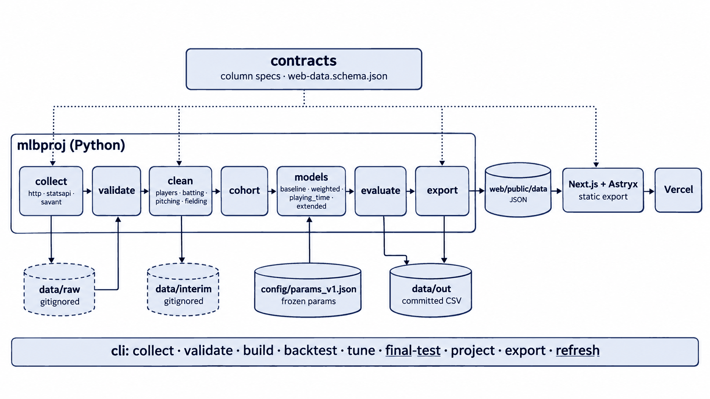
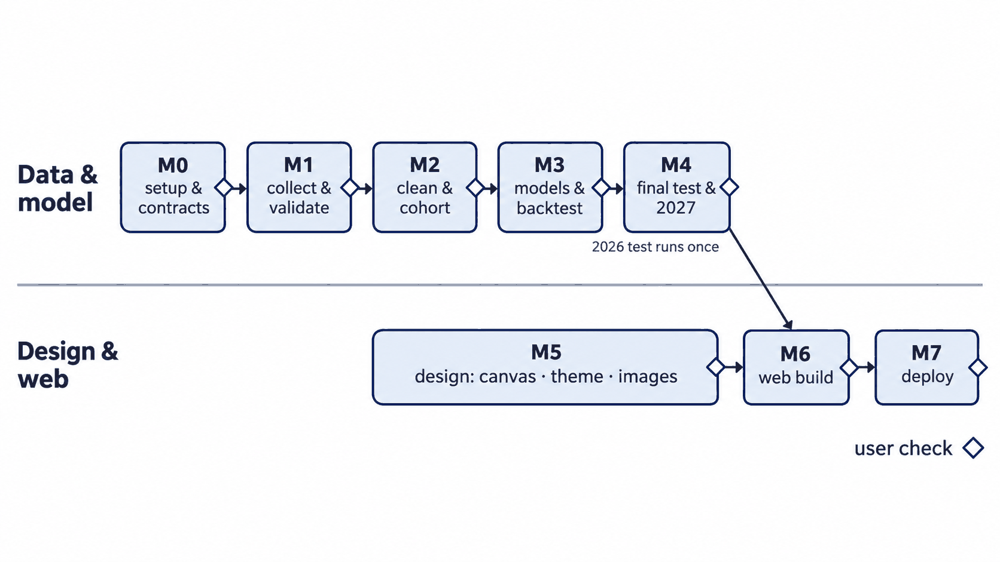
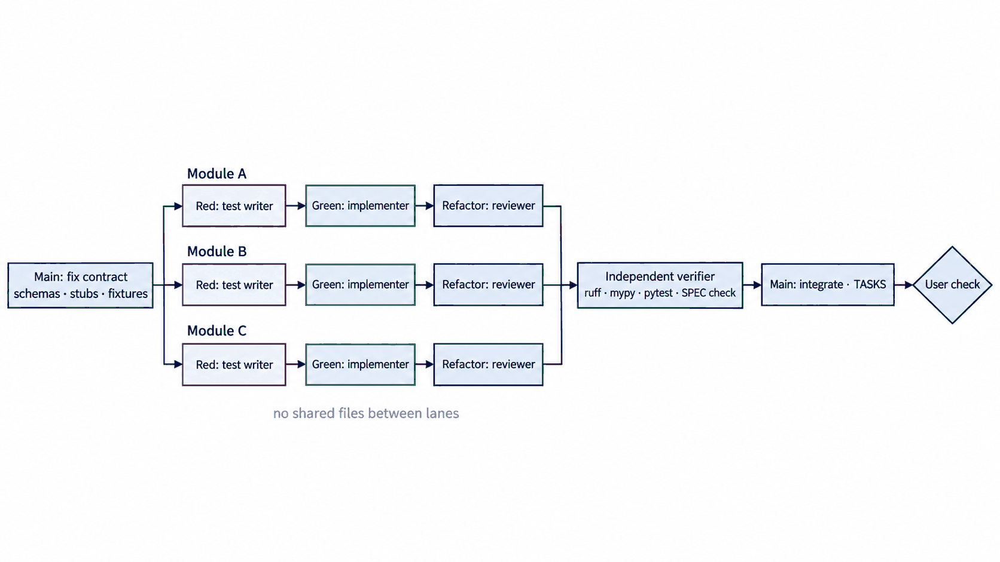

# PLAN.md — mlb-projection

> **상태: v0.3** (2026-11-25) — **SPEC v0.5 WAR 추가**를 반영해 모듈(§2-2 · §2-3 · §2-4)과 마일스톤 M8~M10(§3)을 더했다. 아래는 v0.2.3까지의 기록이다.
> v0.3.1 (M8): WAR 정제 표는 별도 표 `war_seasons`(`mlbproj/clean/war.py`), 검사는 `validate_war.py`(보고서 따로), 모델 `models/war.py`, 검증 · 봉인 · war.json은 `war_eval.py`, 명령은 `cli_war.py`. `tune-war` 보고는 대상 전원 MAE만 — 주전급 풀타임 비율은 `backtest-war`(같은 명령이 이어서 씀)에 있다. war.json은 `export.write_web`을 쓰지 않는다(선수 상세를 지운다).
> v0.2.3 (2026-11-25). v0.1(같은 날 사용자 확인) 뒤 SPEC v0.3의 D26·D27을 반영해 패키지(§6)와 리스크(§7)를 고쳤다. v0.2.1은 M3에서 정한 조정 순서(§2-3, SPEC D28)와 M4 확장 모델·채택표·웹 데이터 커밋 보류를 적었다. v0.2.3은 배포 방식을 로컬 빌드 직접 업로드로 바꿨다(SPEC D32). v0.2.2는 내보내기에 과거 오차 80% 범위(SPEC D29, `data/out/bands.csv`·웹 JSON `bands`)를 더했다. 기준 문서는 `docs/SPEC.md` v0.5다. 문서끼리 다르면 SPEC이 기준이다.
> 결정 P1~P4는 2026-11-23 사용자 답이다. 작업 항목과 진도는 `docs/TASKS.md`에 있다.

---

## 1. 계획 결정

| ID | 항목 | 결정 | 근거 |
|---|---|---|---|
| P1 | 패키지 | 아래 §6 목록을 승인받았다. 목록에 없는 패키지를 추가할 때는 다시 확인받는다 | 워크스페이스 의존성 규칙 |
| P2 | DESIGN 시점 | M1(수집)이 끝나면 M5(DESIGN)를 시작해 M2~M4와 **병행**한다. 웹용 JSON 형식은 M0에서 먼저 고정한다. 화면 구현(M6)은 시안 합의와 M4가 모두 끝난 뒤에 한다 | 사용자가 시안을 검토하는 시간이 생겨 전체 기간이 짧아진다 |
| P3 | Workflow 강도 | 마일스톤마다 **모듈별 3단(Red 테스트 작성 → Green 구현 → Refactor 리뷰) + 독립 검증 1명**. 워크플로당 에이전트는 10명 이하다. 계약 고정·통합·TASKS 갱신·사용자 보고는 메인 세션이 맡는다(§4) | SPEC D4 |
| P4 | 테스트 픽스처 | **실제 응답에서 잘라 쓴다.** 선수 수는 파일당 12명 이하로 제한한다. 출처·받은 날짜·선택한 선수와 이유를 `tests/fixtures/SOURCE.md`에 적는다. 실제로 생기지 않는 경계 사례(K=0 등)는 `tests/fixtures/synthetic/`에 따로 만들어 섞지 않는다 | 사용자 결정. 공개 저장소에 MLB 원본 일부가 들어가므로 규모를 작게 유지한다(SPEC E13) |

---

## 2. 아키텍처

### 2-1. 디렉토리 구조

```
mlb-projection/
├── CLAUDE.md                  # 프로젝트 규칙·실행·검증 명령 (M0)
├── README.md / README_KO.md   # 첫 푸시부터 (SPEC D22), M7에서 완성
├── pyproject.toml             # 패키지 정의 + ruff·mypy·pytest 설정
├── requirements.txt           # pandas
├── requirements-dev.txt       # pytest, ruff, mypy, pandas-stubs
├── mlbproj/                   # 파이프라인 패키지
│   ├── contracts.py           # 열 정의, 행 타입, 상수 (메인이 고정)
│   ├── collect/  http.py · statsapi.py · savant.py
│   ├── validate.py            # F2 완전성 검사
│   ├── clean/    players.py · batting.py · pitching.py · fielding.py
│   ├── cohort.py              # F4 예측 대상, F5 사용 기간
│   ├── models/   league.py · baseline.py · weighted.py · playing_time.py · extended.py · war.py(v0.5)
│   ├── evaluate.py            # F10 MAE·그룹·기준선
│   ├── tune.py                # 2024·2025로 파라미터 조정
│   ├── export.py              # CSV + 웹 JSON
│   └── cli.py                 # python -m mlbproj <명령>
├── contracts/web-data.schema.json   # 파이프라인·웹이 함께 쓰는 JSON 계약
├── config/params_v1.json      # 고정 파라미터 (M3 끝에 커밋)
├── tests/  fixtures/ · fixtures/synthetic/ · live/ · test_*.py
├── data/raw/                  # 원본 (gitignore, SPEC D6)
├── data/interim/              # 정제 표 (gitignore, 언제든 다시 만든다)
├── data/out/                  # 예측·검증 CSV (커밋)
├── web/                       # Next.js 16 + Astryx (public/data/*.json, public/images/)
└── docs/  SPEC · PLAN · DESIGN · TASKS · images/
```



*그림 1. 모듈과 데이터 저장 위치. 점선 원통(`data/raw`·`data/interim`)은 커밋하지 않는다. `contracts`는 메인 세션이 고정하는 공유 계약이고, 에이전트는 읽기만 한다. 모든 단계는 `cli` 명령으로 실행한다.*

### 2-2. 모듈 의존관계와 계약

| 모듈 | 입력 | 출력 | 의존 |
|---|---|---|---|
| `collect.http` | URL | 응답 바이트 (캐시·재시도·1초 간격·일반 UA, SPEC N3) | — |
| `collect.statsapi` | 시즌, 역할 | `data/raw/statsapi/{season}_{bat\|pit}.json`, `people_{batch}.json` | http |
| `collect.savant` | 시즌, 종류 | `data/raw/savant/{season}_{batter\|pitcher\|oaa\|frv}.csv` | http |
| `validate` | raw 한 시즌 | 검사 결과(통과/실패 + 사유). 실패하면 이후 단계를 막는다 | contracts |
| `clean.*` | 통과한 raw | `players`, `batting_seasons`, `pitching_seasons`, `fielding_seasons` (SPEC §6) | contracts, validate |
| `cohort` | 정제 표, 목표 시즌 Y | 역할별 대상 선수와 사용 시즌 목록(F4·F5) | clean |
| `models.league` | 정제 표 | 시즌별 리그 평균·FIP 상수 | clean |
| `models.baseline` | cohort | 직전 시즌 예측(F6) | league |
| `models.weighted` | cohort, params | 성분 가중 + 리그 평균 회귀 비율 예측(F7) | league |
| `models.playing_time` | cohort, 학습 시즌 | PA·IP 예측(F8) | league |
| `models.extended` | 위 + 나이·Statcast | 확장 예측(F9), ERA 구성 지표 모델(D11) | weighted, playing_time |
| `evaluate` | 예측, 실제 | MAE 표(모델 × 지표 × 그룹, 기준선, 제외 건수) | models |
| `export` | 예측, 검증, 과거 기록 | `data/out/*.csv`, `web/public/data/*.json` | contracts |
| `collect.statsapi` (v0.5) | 시즌, 그룹 | `data/raw/statsapi/{season}_{bat\|pit}_saber.json` (SPEC F1 ⑤) | http |
| `validate` (v0.5) | 세이버메트릭스 한 시즌 | F2 ⑦ — `totalSplits` = 행 수, `war` 결측 0, 역할 행 포함, 리그 WAR 합 570 · 430 × 경기 비율 ±1 | contracts |
| `clean.batting` · `clean.pitching` (v0.5) | 통과한 세이버메트릭스 | 정제 표에 `war`·구성 열(SPEC §6) | validate |
| `models.war` (v0.5) | cohort, 정제 표, 예측 출전량, war params | 역할별 WAR 비율(F18) · 예측 WAR · 풀타임 환산 · 선발/불펜 · 투타 합산(F19) | weighted, playing_time |
| `evaluate_war` (v0.5) | WAR 예측, 실제 | WAR MAE(전원 · 그룹 · WAR 2 이상 · 주전급 풀타임 비율) + 기준선 두 개(F20) | models.war |

**계약 고정 방식.** 메인 세션이 마일스톤을 시작하기 전에 다음을 커밋한다.
1. `contracts.py`의 열 이름·타입
2. 해당 마일스톤 모듈의 **함수 시그니처 스텁**(본문은 `raise NotImplementedError`)
3. 픽스처

그래서 Red 단계의 테스트는 import 오류가 아니라 실제 단언으로 실패한다. 웹과 공유하는 계약은 `contracts/web-data.schema.json` 하나다. 파이프라인 테스트는 `export` 결과를 이 스키마로 검사하고, 웹은 같은 스키마에서 TypeScript 타입을 만든다.

### 2-3. 모델 설계 요점

| 대상 | 방식 | 파라미터 |
|---|---|---|
| 타자 비율 | 성분(1B·2B·3B·HR·BB·HBP·SF·AB per PA)을 시즌 가중합한다. 성분마다 `(Σw·count + R·리그율) / (Σw·PA + R)`로 회귀하고, 그 결과로 OBP·SLG·OPS·HR/PA를 계산한다 | 가중치 w1~w5(초기 5·4·3·2·1), 성분별 회귀 표본 R |
| 투수 비율 | K·BB·HBP·HR per BF로 K−BB%를 계산한다. ERA 후보는 (a) 가중 ER/아웃 회귀 (b) 구성 지표 ERA(FIP식 + 리그 보정) (c) xERA 가중 중 MAE로 고른다(D11) | 같은 형식 + 후보 선택 |
| 출전량 | 선형 모델 `PA_Y ~ PA_{Y−1}, PA_{Y−2}, 공백 시즌 수, (투수) GS/G`. 0 미만은 0으로 자른다. **목표 Y의 계수는 Y−1 이하 목표들로만 적합한다**(N2) | numpy 최소제곱(pandas에 포함). 2020 입력은 162/60 환산(D9) |
| HR | 예상 PA × 예상 HR/PA | — |
| 확장 | 나이 곡선, K%·BB%, Statcast(xwOBA·Barrel%·EV, 투수 xERA·Whiff%)를 성분 회귀식에 더한다. 2024·2025 MAE가 나아질 때만 채택한다 | 항목별 채택 여부 |

**파라미터 고정 절차.** `tune`은 목표 2024·2025만 읽는다. 격자 탐색 순서는 타자 OPS(시즌 가중치 × 공통 R) → 타자 HR(HR 성분 R만, OPS 평균 MAE를 지키는 후보 중, SPEC D28) → 투수 K−BB%(가중치 × 공통 R) → 투수 ERA(방식 er/fip × R_er)이고, 두 해 평균 MAE로 고른다. 후보 결과는 `data/out/tune_report.csv`, 과거 검증표는 `data/out/backtest.csv`·`.json`에 남는다. 조정이 끝나면 `config/params_v1.json`을 만들고, 그 해시를 TASKS에 적은 뒤 커밋한다. `final-test --target 2026`은 파라미터 파일이 커밋된 상태가 아니면 실행을 거부한다. 결과는 `data/out/final_test_2026.json`에 남긴다. 다시 실행하려면 `--rerun` 사유를 받아 기록에 남긴다(SPEC F10 "한 번만").

**확장 모델과 채택표 (M4).** 확장 모델(F9)은 가중 예측 위에 지표별 선형 잔차 보정을 얹는다. 특성은 나이·K%·Statcast(`contracts.EXT_FEATURES`)이고, 계수는 목표 이전 시즌들(2021~Y−1, 출전량은 2023~)의 "실제 − 가중 예측"으로만 맞춘다(N2). 지표마다 2024·2025 평균 MAE가 가중 모델보다 낮을 때만 채택한다. 순서는 타자 PA → HR → OPS, 투수 IP → ERA → K−BB%이며, 출전량을 먼저 정해야 HR을 평가할 수 있기 때문이다. 채택표는 `config/extended_v1.json`으로 커밋하고, `final-test`는 파라미터와 채택표가 **둘 다** 커밋된 상태에서만 돈다. 역할마다 채택한 지표가 하나라도 있으면 그 역할의 최종 모델은 "extended", 없으면 "weighted"다.

**WAR 모델 (v0.5, SPEC F18~F20·D35·D36).** 기존 여섯 지표 모델 위에 **얹기만** 한다 — `config/params_v1.json`·`config/extended_v1.json`은 그대로 두고(해시 확인), WAR 파라미터는 `config/war_v1.json` 하나에 둔다.
- 비율 = `(Σw·WAR + R·리그 비율) / (Σw·출전 + R)`, w = params_v1의 시즌 가중치, 출전은 타자 PA · 투수 아웃. 리그 비율은 Y−1 역할 행의 WAR 합 / 출전 합.
- 예측 WAR = 비율 × 기존 최종 모델의 예측 출전량(PA, IP × 3). 풀타임 = 비율 × (600 PA · 선발 540 · 불펜 195 아웃). 선발은 입력 기간 `Σw·GS / Σw·G ≥ 0.5`.
- 조정(`tune-war`)은 목표 2024·2025만, R 격자(타자 300~4800 PA · 투수 150~2400 아웃)를 두 해 평균 MAE(대상 전원)로 고른다. 주전급 풀타임 비율 MAE를 함께 보고하되 선택 기준은 하나로 둔다.
- `final-test-war --target 2026`은 `config/war_v1.json`이 커밋된 상태에서만 돌고 `data/out/final_test_2026_war.json`에 남긴다. 다시 돌리려면 `--rerun` 사유(D31과 같은 장치). 기존 `final_test_2026.json`은 건드리지 않는다.
- 투타 겸업(F12)은 역할 행을 따로 계산해 `war_rankings`에서 합친다. 2027 예측 대상 중 두 역할 대상은 오타니 · Brett Phillips(E9) — Phillips는 투구 영향이 0.003이닝 이하(TASKS 이슈)라 합산해도 거의 같다.

**웹 데이터 커밋 (정함 → 넣지 않는다, SPEC D32).** `export`가 쓰는 `web/public/data/`(선수별 과거 기록 약 2,500개 포함)는 M4에서 커밋하지 않는다(`.gitignore`). 공개 저장소에 선수별 시즌 기록을 통째로 올리는 것이 MLBAM 고지의 "non-bulk"(SPEC E13)에 맞는지, 배포 방식과 함께 M7 전에 정한다(TASKS 미해소 이슈 ⑥).

### 2-4. CLI (SPEC D25 수동 갱신)

```
python -m mlbproj collect   --seasons 2019-2026      # F1
python -m mlbproj validate  --seasons 2019-2026      # F2
python -m mlbproj build                               # F3~F5 정제·대상
python -m mlbproj tune      --targets 2024,2025      # 파라미터 → config/params_v1.json
python -m mlbproj adopt     --targets 2024,2025      # 확장 모델 채택표 → config/extended_v1.json (F9)
python -m mlbproj backtest  --targets 2024,2025      # F10 과거 검증표 (2026은 거부)
python -m mlbproj final-test --target 2026            # 파라미터·채택표 커밋 뒤 1회
python -m mlbproj tune-war  --targets 2024,2025      # (v0.5) WAR 회귀 표본 → config/war_v1.json
python -m mlbproj backtest-war --targets 2024,2025   # (v0.5) WAR 과거 검증 (2026은 거부)
python -m mlbproj final-test-war --target 2026        # (v0.5) war_v1.json 커밋 뒤 1회
python -m mlbproj export                              # 2027 예측(F11) → 검토용 CSV + 웹 JSON
python -m mlbproj refresh                             # collect → … → export 한 번에 (수동 갱신)
```

---

## 3. 마일스톤



*그림 2. 마일스톤 순서. M5(DESIGN)는 M1이 끝난 뒤 M2~M4와 나란히 진행한다(P2). M6(웹)은 M4의 예측과 M5의 시안 합의가 모두 있어야 시작한다. 마름모는 마일스톤마다 사용자 확인을 받는 지점이다. 2026 최종 검증은 M4에서 한 번만 돌린다.*

| 마일스톤 | 범위 (SPEC ID) | 실행 | 완료 기준 |
|---|---|---|---|
| **M0 기반·계약** | git 초기화, `.gitignore`(data/raw·interim·venv·node_modules·.next·out), **Homebrew Python 3.13 venv**(E17), 패키지 설치, ruff·mypy·pytest 설정, 프로젝트 CLAUDE.md, README 2종 골격, `contracts.py` + `web-data.schema.json`, 실제 데이터 픽스처(P4), 웹 골격 빌드 확인(Next.js + Astryx + Tailwind 정적 export, **화면 없이**), 깃허브 공개 저장소 생성·첫 푸시(사용자 확인 후) | 메인 단독 | `ruff`·`mypy`·`pytest`(빈 스위트)·웹 `build` 통과, 첫 푸시 |
| **M1 수집·검증** | F1·F2, N3. 모듈 A `collect.http`+`statsapi`, B `collect.savant`(리더보드·OAA·FRV), C `validate` | Workflow | 2019~2026 원본 수집, 전 시즌 검증 통과. 수치가 SPEC E2·E6과 맞음(타자 Savant = API PA>0, 투수는 F2 ④ 포함 관계) |
| **M2 정제·대상** | F3~F5, D8·D9·D21·D23. 모듈 A `clean.players`+`batting`, B `clean.pitching`, C `clean.fielding`+`cohort` | Workflow | 정제 표 재현 가능, 역할 판정 결과(2019·2021 투수 타석 제외)와 대상 규모를 기록. SPEC E9 대비 차이를 설명 |
| **M3 모델·과거 검증** | F6~F8·F10, N2. 모듈 A `models.league`+`baseline`+`evaluate`(누설 테스트 포함), B `models.weighted`, C `models.playing_time` → 메인이 `tune` 실행 | Workflow + 메인 | 2024·2025 검증표. OPS·K−BB%가 리그 평균보다 낫다. `params_v1.json` 고정·커밋 |
| **M4 확장·최종 예측** | F9·F11·D11·N1·N6. 모듈 A `models.extended`, B `export`(스키마 검사·크기 1MB), C `cli refresh`+재현성 테스트 → 메인이 **2026 최종 검증 1회** → 2027 예측 | Workflow + 메인 | v0.1 완료 기준 1·2(SPEC §7). 2026 결과를 그대로 사용자에게 보고 |
| **M5 DESIGN** (M1 이후 병행) | IA → 와이어프레임 → Astryx 전용 테마 토큰 → Claude Design 디자인 시스템·캔버스 시안(예측표·선수 상세·검증·소개) → Codex 이미지(히어로·섹션·OG, D19) → O6 차트·O7 사진 결정 → **사용자 합의** | 메인 + Codex | `docs/DESIGN.md`에 합의 기록, 이미지 목록·프롬프트 기록 |
| **M6 웹 구현** | F13~F17, N6·N9·N10. 메인이 앱 골격·테마·데이터 로더·스키마 타입을 고정한 뒤 모듈 A 예측표, B 선수 상세(차트·수비), C 검증·소개·공통(고지·출처·이미지·OG) | Workflow | 웹 lint·test·build 통과, 시안 대비 화면 확인(스크린샷), 명도 대비 검사 |
| **M8 WAR 데이터·모델 (v0.5)** | SPEC F1 ⑤·F2 ⑦·F3·F18~F20·D33~D36. 메인 계약(열 · 스키마 · 스텁 · 세이버메트릭스 픽스처) → 레인 A `collect.statsapi` 세이버메트릭스 + `validate` ⑦ + `clean` WAR 열, B `models.war`(비율 · 예측 · 풀타임 · 선발 판정 · 투타 합산) + `tune-war`, C `evaluate_war` + `backtest-war` + `final-test-war`(봉인 · 사유) + `export` WAR 필드 → 메인이 실수집(16회) · 조정 · 커밋 → **2026 WAR 시험 1회** → 2027 WAR 예측 | Workflow + 메인 | SPEC §7-1 1~4. 기존 파라미터 · 채택표 · 2026 기록 해시 그대로. 2026 WAR 결과를 그대로 보고 |
| **M9 WAR 화면 (v0.5)** | SPEC F21·F22·D34·D35·D39. DESIGN 시안(WAR 순위 탭 · 선수 상세 WAR 카드 · 검증 WAR) → **사용자 합의** → 레인 A WAR 순위 표, B 상세 WAR, C 검증 · 소개 · 공통 | 메인(시안) + Workflow | 웹 lint · test · build, 시안 대비 화면 · 명도 대비 확인 |
| **M10 WAR 배포 (v0.5)** | SPEC N7·D32. 보안 점검 → 로컬 빌드 직접 업로드 → README 2종 갱신 | 메인 | 공개 URL에서 WAR 화면 동작, 워크스페이스 표 갱신 |
| **M7 배포** | SPEC N7·D32. 보안 리뷰·시크릿·`data/raw` 미추적 확인, 공개 저장소 산출물 점검, Vercel 배포(로컬 빌드 `web/out`을 기존 토큰으로 직접 업로드 — 웹 JSON은 저장소에 넣지 않는다), README 2종 완성(스크린샷) | 메인 | 공개 URL 동작, 워크스페이스 프로젝트 표 갱신 |

---

## 4. 오케스트레이션 (SPEC D4, P3)



*그림 3. 한 마일스톤의 Workflow. 모듈마다 테스트를 쓰는 에이전트와 구현하는 에이전트가 다르다. 레인끼리는 파일을 공유하지 않는다. 독립 검증 에이전트가 전체 검사를 돌린 뒤 메인 세션이 통합하고 TASKS를 갱신하고 사용자에게 보고한다.*

| 단계 | 담당 | 하는 일 | 산출 (구조화 출력) |
|---|---|---|---|
| 계약 | 메인 | 열 정의·스텁·픽스처 커밋, 모듈별 파일 경계와 SPEC ID를 Workflow `args`로 넘긴다 | — |
| Red | 테스트 작성 에이전트 | 맡은 모듈의 SPEC 요구사항으로 `tests/test_{module}.py`를 쓰고, 스텁에서 **실패하는 것을 확인**한다. 구현 파일은 건드리지 않는다 | 테스트 목록, 실패 출력 요약 |
| Green | 구현 에이전트 | 테스트를 고치지 않고 통과시키는 최소 구현을 쓴다. 테스트가 틀렸다고 판단하면 고치지 않고 사유를 보고한다 | 변경 파일, 통과 출력 |
| Refactor | 리뷰 에이전트 | SPEC 대조, 누설·경계 조건 점검, 테스트를 유지하며 정리하고 남은 문제를 보고한다 | 지적 목록(심각도), 정리 내역 |
| 검증 | 독립 검증 에이전트 | 전체 `ruff`·`mypy`·`pytest`(웹은 lint·test·build), 완료 기준 대조, 레인 사이 계약 위반 확인 | 통과/실패, 근거 |
| 통합 | 메인 | 결과를 직접 다시 돌려 확인하고, 실데이터 실행(수집·검증표 등)과 TASKS 갱신·커밋, 사용자 보고 | — |

운영 규칙

- **에이전트 수**: 3 모듈 × 3단 + 검증 1 = 10명 이하. 모듈이 4개 이상이면 묶거나 워크플로를 나눈다.
- **파일 경계**: 레인마다 쓸 수 있는 파일을 프롬프트에 명시한다. 경계가 분리되어 있으므로 worktree 격리는 쓰지 않는다. 레인 안에서는 자기 테스트 파일만 돌리고, 전체 스위트는 검증 단계에서 돌린다.
- **실데이터와 외부 호출**: 에이전트는 픽스처로만 작업한다. 실제 수집·최종 검증·배포는 메인이 한다.
- **2026 최종 검증**: 에이전트에게 맡기지 않는다. 메인이 파라미터 커밋을 확인한 뒤 한 번 실행한다.
- **재개**: 실패한 레인은 Workflow `resumeFromRunId`로 그 지점부터 다시 돌린다.
- **문서 그림**: SDD 문서에 그림이 필요하면 Codex(`codex exec`)로 만들고 직접 열어 라벨을 대조한다(워크스페이스 문서 그림 원칙).

---

## 5. 테스트 전략

| 층 | 대상 | 방식 |
|---|---|---|
| 단위 | 계산 함수(IP→아웃, OPS 성분, 회귀식, FIP 상수, 2020 환산, 역할 판정, 사용 기간) | 손으로 계산한 기대값과 비교. 테스트 이름은 `test_{module}_{scenario}` |
| 픽스처 기반 | 수집 파서, 검증, 정제, 대상 선정 | 실제 응답에서 잘라 낸 픽스처(P4). 아래 사례가 하나 이상씩 들어가게 고른다 |
| 불변식 | 누설 방지(N2) | 목표 Y 이후 시즌에 "독" 값을 넣어도 예측이 같아야 한다. 출전량 학습 표본에 Y 이후 목표가 없어야 한다 |
| 재현성 | N1 | 같은 원본으로 두 번 돌린 산출물의 해시가 같다 |
| 계약 | 웹 JSON | `export` 결과를 `web-data.schema.json`으로 검사한다. 웹 빌드 때도 같은 스키마로 검사한다 |
| live | 외부 형식 변화 | `tests/live/`(기본 실행에서 제외, `-m live`). 출처마다 1회 요청해 필수 열이 있는지만 본다 |
| 웹 | F13~F17 | Vitest + Testing Library(정렬·검색·전환·상세 렌더링·고지 표시), 빌드 성공 |

**픽스처에 넣을 사례** (실제 선수에서 고른다)

- 5시즌 모두 출전한 선수
- 2024 데뷔, 2026 데뷔
- 2025 결장 후 복귀, 2023 이후 미출전
- 투타 겸업(E7)
- 등판한 야수, 2021 이전 투수 타석(E10)
- 시즌 중 이적(합산 1행)
- 2020 시즌 기록
- 포수(FRV 세부)

`tests/fixtures/SOURCE.md`에 출처 URL, 받은 날짜, 선수 ID와 선택 이유를 적는다.

---

## 6. 패키지 (P1 승인)

| 구분 | 패키지 | 비고 |
|---|---|---|
| Python 런타임 | `pandas` (numpy 포함) | HTTP는 표준 라이브러리 `urllib`. venv는 Homebrew Python 3.13 |
| Python 개발 | `pytest`, `ruff`, `mypy`, `pandas-stubs` | `requirements-dev.txt` |
| 웹 런타임 | `next@16`, `react@19`, `react-dom@19`, `@astryxdesign/core`·`@astryxdesign/theme-*`(기반 테마 1종)·`@astryxdesign/charts`를 **같은 canary 빌드로 정확히 고정**(D26, M0의 0.7.17에서 M6 시작 때 바꾼다), `@stylexjs/stylex@^0.19` | 테마는 DESIGN에서 기반 1종을 골라 덮어쓴다. charts는 d3-array·d3-scale·d3-shape를 끌어온다 |
| 웹 개발 | `typescript`, `tailwindcss@4`, `@tailwindcss/postcss`, `@astryxdesign/cli`, `vitest`, `@testing-library/react`, `@testing-library/jest-dom`, `jsdom`, `eslint`, `eslint-config-next` | lockfile 커밋 |
| 차트 | `@astryxdesign/charts` canary | SPEC D26 (2026-11-24 사용자 결정·설치 승인) |
| 아이콘 | `@heroicons/react@2.2.0` (MIT) | Astryx 페이지 템플릿(table-page·documentation-technical)이 쓴다. 2026-11-24 사용자 승인(M6) |
| 글꼴 | `@fontsource/noto-sans-kr@5.3.1` (OFL) | 한글 본문·제목. Astryx 테마 진단이 설치된 글꼴 패키지만 인정한다 (2026-11-24 사용자 승인) |

`astryx init`은 `AGENTS.md`/`CLAUDE.md`에 안내문을 쓴다(SPEC E14). M0에서 실행한 뒤 프로젝트 CLAUDE.md 변경분을 검토하고 필요한 부분만 남긴다.

---

## 7. 리스크

| ID | 리스크 | 대응 |
|---|---|---|
| R1 | python.org Python에서 HTTPS 인증서 실패(E17) | Homebrew Python으로 venv를 만든다. 윈도우는 별도 확인 |
| R2 | Savant·API 형식 변경, 요청 제한 | 캐시·간격·재시도, live 테스트, 검증 단계에서 멈춤 |
| R3 | MLBAM 이용 조건(E13) — 공개 저장소, 실제 픽스처(P4) | 원본 비커밋, 픽스처 소규모·출처 기록, 공개 화면은 예측과 필요한 과거 기록만, 출처 표기 |
| R4 | Astryx 베타·**canary**의 깨지는 변경 (D26 — core·theme·charts가 canary) | 하나의 canary 빌드로 정확히 고정 + lockfile. 올릴 때는 빌드·테스트·화면 확인 후. 고칠 수 없으면 차트만 직접 그린 SVG로 바꾼다 |
| R5 | Next.js 16 정적 export와 Astryx(클라이언트 테마 공급자) 호환 | M0에서 화면 없는 빌드로 먼저 확인 |
| R6 | ERA 예측력이 약함(E11) | 구성 지표 후보, 기준선 병기, 결과를 숨기지 않음(SPEC §7-2) |
| R7 | 2024·2025에 과적합 | 2026은 고정 후 1회, 파라미터 해시 기록 |
| R8 | 최근 5시즌 전체 대상(D3)이라 출전량 MAE가 미출전자에 좌우됨 | "직전 시즌 출전 / 미출전" 그룹 MAE를 따로 낸다 |
| R9 | Workflow 토큰 비용 | 워크플로당 10명 이하, 기계적 단계는 effort를 낮춘다. 통합 검증은 메인이 한다 |
| R10 | 생성 이미지의 글자 깨짐·상표·인물 | 라벨은 짧은 영어, 넣기 전에 직접 확인(N9). UI 이미지는 글자 없이 |
| R11 | Vercel 계정 2단계 인증 잠김(CLI 로그인 불가) | 기존 `VERCEL_TOKEN`을 사용자 승인 후 쓴다(2026-11-25 승인, 값은 출력하지 않고 명령에만). 토큰이 만료되면 배포가 막힌다 — 2FA 복구가 근본 해결 |
| R12 | 맥·윈도우 교차 작업 시 `data/raw`가 없음 | `refresh` 한 번으로 다시 받는다 |
| R13 | 공식 선수 사진의 저작권 (D27, E13) | 복사하지 않고 MLB 서버에서 불러온다, "선수 사진 © MLB" 표기, 실패 시 이니셜 배지, 설정 하나로 끌 수 있게 한다. 요청을 받으면 바로 끈다 |
| R14 | (v0.5) MLB Stats API WAR은 fWAR · bWAR과 값이 다르고, 산식이 공개 문서로 확인되지 않는다 | "WAR(MLB Stats API 기준)" 표기와 설명. 리그 합 항등식(F2 ⑦)으로 형식이 바뀌면 멈춘다 |
| R15 | (v0.5) 예측 WAR이 출전량 보수성(E24)을 그대로 물려받아 주전급 순위가 낮게 나온다(E27) | 풀타임 환산을 나란히 보여주고 정렬을 고르게 한다(D35). 출전량 모델 개선은 별도 과제 |
| R16 | (v0.5) WAR 추가가 기존 2026 기록 · 파라미터 · 채택표를 건드림 | 별도 파일(`config/war_v1.json`, `final_test_2026_war.json`), 기존 해시를 테스트로 고정 |
