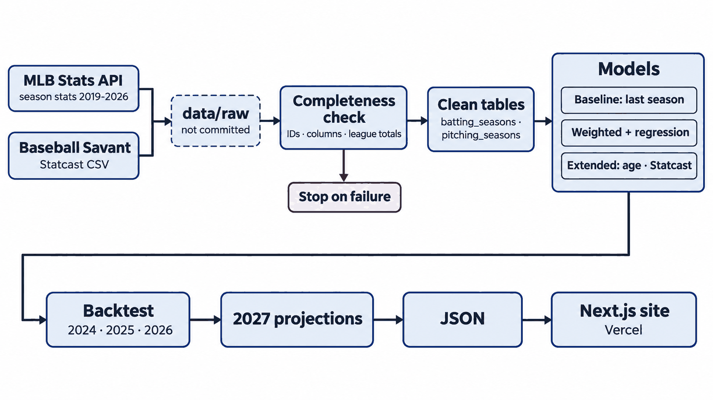
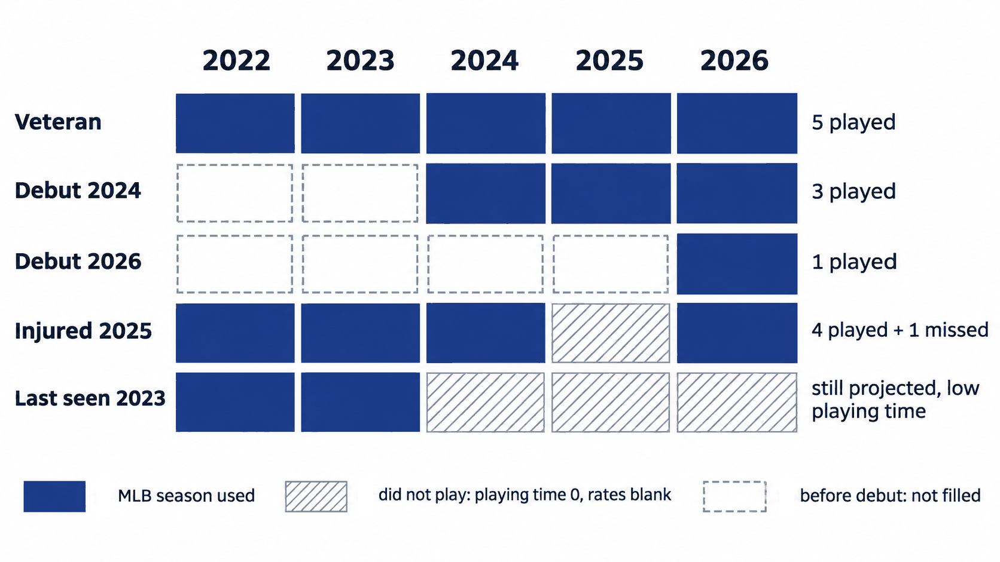
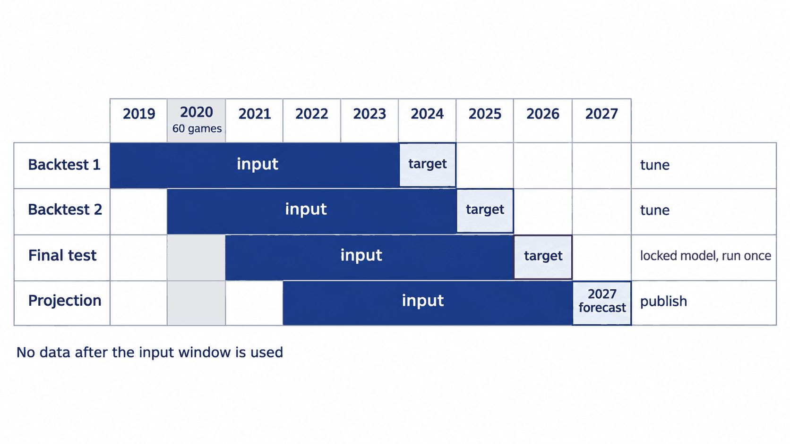

# SPEC.md — mlb-projection

> **상태: v0.3** (2026-11-24). 원본 아이디어는 `idea_md/mlb-2027-projection-ideas.md`(v0.1 기획 초안)다.
> 데이터 출처·예측 신호는 실제로 받아 보고 확인한 뒤 적었다(§2). 결정 D1~D4·D18~D25는 사용자가 고른 것이고, D5~D17은 추천안이다. 바꾸고 싶은 항목이 있으면 이 문서부터 고친다.
> 열린 결정은 없다(O6·O7은 2026-11-24 D26·D27로 닫았다).
>
> **v0.3 (2026-11-24)**: DESIGN 단계에서 O6·O7을 사용자 결정으로 닫았다. M2 실측으로 E9(대상 규모)를 역할 규칙 기준으로 정정하고, 데이터 시작(2019) 전 기록을 데뷔 연도로 보완하는 규칙(E21, F5)을 더했다. 차트는 Astryx charts canary(본체·테마도 같은 canary 빌드로 고정, D26), 선수 사진은 MLB 공식 사진을 MLB 이미지 서버에서 불러온다(D27). 두 결정 모두 추천안과 다르며 위험과 대응을 함께 적었다.
>
> **v0.2.3 (2026-11-24)**: M1 구현 중 F2 ②의 범위를 분명히 했다. 값이 같은 중복 행을 합치는 것은 Savant CSV뿐이고, API 기록의 중복은 값이 같아도 실패다(E1: 선수당 1행).
>
> **v0.2.2 (2026-11-24)**: M1 계약을 고정하며 8시즌 리그 합계를 다시 셌다. 리그 PA 합 = BF 합이 모든 시즌에서 정확히 같고, 이닝 표기와 아웃 수도 모두 같다(E20). F2에 응답 완전성·PA=BF 항등식·선수 정보 검사를 더했다.
>
> **v0.2.1 (2026-11-24)**: M0 픽스처를 만들며 8시즌 전체를 다시 대조했다. E2(투수 차이)·E10(등판한 야수 규모)의 11-23 기록이 틀려서 고쳤고, 양손 투수 중복 행(E19)을 찾았다. 그에 맞춰 F2 검사 ②·④를 바꿨다.
>
> **v0.2 (2026-11-23)**: 열린 결정 O1~O5를 사용자 답으로 닫았다(D21~D25). 수비 OAA·FRV를 v0.1 상세 화면에 넣고, 저장소는 공개, 은퇴는 표시용, 예측 범위는 원안대로, 갱신은 수동이다. `active` 필드(E16)·SSL 인증서(E17)·FRV CSV(E18)를 실측했고, 문서 그림 3장을 넣었다.

---

## 1. 프로젝트 목표

**재미로 보는 2027년 MLB 선수 성적 예측.** 최근 최대 5시즌 기록으로 2027년 정규시즌 성적을 예측하고, 그 예측이 과거에 얼마나 맞았는지를 함께 보여주는 웹페이지를 만든다.

| 역할 | 예측 지표 | 비율 / 출전량 |
|---|---|---|
| 타자 | OPS, PA, HR | 비율 = OPS(출루·장타 성분), 출전량 = PA, HR = 예상 PA × 예상 타석당 홈런율 |
| 투수 | ERA, IP, K−BB% | 비율 = ERA·K−BB%, 출전량 = IP |

두 역할 모두 **비율과 출전량을 따로 추정**한다. 모든 예측에는 **리그 평균 기준선과 과거 검증 오차**를 같이 붙인다. 실측해 보니 ERA처럼 리그 평균보다 잘 맞추기 어려운 지표가 있었다(E11). 그래서 기준선을 같이 보여주지 않으면 예측이 실제보다 정확해 보인다.

*그림 1. 전체 흐름. 원본은 `data/raw/`에 두고 커밋하지 않는다(D6). 완전성 검사(F2)를 통과하지 못하면 다음 단계로 가지 않는다. 모델은 기준 → 가중 → 확장 순으로 쌓고(D10), 과거 검증을 거친 예측만 JSON으로 웹에 넘긴다(D2).*

### 1-1. 하지 않는 것 (v0.1)

- KBO 예측. v0.2에서 데이터 확보 방법을 정한 뒤 검토한다(D1, E12)
- 수비 예측, 포수 세부 지표(프레이밍·블로킹·도루 저지)
- wRC+·fWAR·xFIP·DRS·UZR 수집·산출. FanGraphs와 SIS는 자동으로 받을 수 없다(E5)
- 세이브 예측. 원안 4단계 "투수 지표 확장"으로 미룬다
- 팀 이동·구장 보정, FA 계약 반영
- MLB 기록이 없는 선수의 예측. 신인, 마이너리그 선수, KBO·NPB에서 오는 선수가 여기에 해당한다
- 시즌 중 실시간 갱신, 판타지·베팅 조언

---

## 2. 사실 확인 기록 (2026-11-23 실측)

추측이 아니라 실제로 받아 보고 확인한 내용이다. 외부 출처가 바뀌면 이 표부터 고친다.

| ID | 확인 내용 | 설계에 미친 영향 |
|---|---|---|
| E1 | MLB Stats API `GET /api/v1/stats?stats=season&group={hitting\|pitching}&season=Y&sportId=1&playerPool=ALL&limit=3000`로 2019~2026 시즌 기록이 다 받아진다. 선수당 1행이고, 시즌 중 이적한 선수도 합산 1행이다. 타격 기록에는 PA·AB·H·2B·3B·HR·BB·IBB·HBP·SF·SH·SO·OBP·SLG·OPS가 있다. 투구 기록에는 G·GS·IP·BF·ER·H·HR·BB·HBP·SO·SV·SVO가 있다 | 기본 기록은 API에서 받는다(D5) |
| E2 | Baseball Savant Custom Leaderboard는 URL 끝에 `&csv=true`를 붙이면 CSV가 바로 받아진다. **타자**: `min=1`로 받은 Savant 타자 ID는 2019~2026 여덟 시즌 모두 API의 PA>0 타자 ID와 정확히 같다(2026년 662명). **투수**: 같지 않다. 2026년 API 868명 중 Savant에 812명이 있다. 빠진 56명은 등판한 야수 48명과 상대 타자 8명 이하인 투수 8명이다. 반대로 등판한 야수 8명은 Savant에 들어 있다. Savant에서 빠진 실제 투수(포지션 P·TWP)는 시즌당 3~11명, 한 명 최대 22 BF(2022), 합계는 리그 BF의 0.1% 미만이다. Savant에만 있는 투수 ID는 어느 시즌에도 없다 *(2026-11-24 정정: 11-23 기록은 "빠진 56명 = 등판한 야수 56명"이었는데, 숫자만 같고 사람은 달랐다)* | Statcast 지표는 Savant에서 받는다. 원안의 수동 다운로드는 필요 없다(D5). 투수 대조 검사는 F2 ④의 포함 관계로 한다 |
| E3 | Savant 투수 CSV의 `p_gs`(선발 등판) 열은 812행 모두 비어 있다. `xera`·`whiff_percent`·`xwoba`는 채워져 있다 | GS는 API에서 받는다 |
| E4 | Savant 수비 리더보드(OAA·FRV)도 `csv=true`로 받아진다. `year` 열은 비어 있다 | 수비 기록을 받으면 요청한 연도로 채운다(O1) |
| E5 | FanGraphs 리더보드 API는 Cloudflare 확인 페이지로 403을 돌려준다 | wRC+·fWAR·xFIP는 v0.1에서 뺀다. FIP는 API 기록과 리그 상수로 직접 계산한다 |
| E6 | 리그 전체 타석(API 선수 합): 2019년 186,517 · 2020년 66,506 · 2021~2026년 181,818~184,104 | 2020년(60경기)은 출전량을 보정해야 한다(D9) |
| E7 | 두 역할 모두 PA≥100·BF≥100인 투타 겸업 선수는 2025·2026 모두 오타니(ID 660271) 1명이다 | 같은 ID로 역할별로 따로 계산한다(F12) |
| E8 | 2026년에 출전한 타자 662명이 2022~2026에 가진 시즌 수: 1시즌 112명 · 2시즌 90명 · 3시즌 92명 · 4시즌 92명 · 5시즌 276명 | 짧은 경력은 소수가 아니다. 그룹별 오차를 따로 본다(D13) |
| E9 | 최근 5시즌 출전자 전체(D3)의 규모 — **역할 규칙(D8) 기준**(2026-11-24 M2 정제 표로 다시 셈): 2027 예측 대상 타자 1,144명 · 투수 1,490명, 이 중 2026년 출전은 659명 · 812명. 과거 검증 대상: 2024년 타자 1,118 · 투수 1,451, 2025년 1,124 · 1,473, 2026년 1,160 · 1,530명. 투타 두 역할 대상은 2027년 2명(오타니, Brett Phillips). 2027 타자의 기간 안 시즌 수: 1시즌 302 · 2 224 · 3 183 · 4 159 · 5 276명 *(11-23 기록은 2027 타자 1,164·투수 1,693명이었다. 역할 규칙 없이 세어 투수의 타격과 등판한 야수(약 200명)가 섞였다)* | 대상의 40% 가까이가 직전 시즌 미출전이다. 출전량 모델이 공백을 반영해야 한다(F8) |
| E10 | 2021년까지는 투수도 타석에 섰다. 타격 기록 중 포지션 P: 2019년 355명(최대 80PA), 2021년 390명(최대 82PA). 2022년 이후는 시즌당 6명 이하·최대 2PA다. 투구 기록이 있는 야수(포지션 P·TWP가 아닌 투구 기록)는 2019년부터 56·26·59·64·59·53·70·56명이고(2020은 60경기), 한 명 최대 54 BF(2025)다 *(2026-11-24 정정: 11-23 기록은 "56~64명·최대 49 BF")* | 역할은 API 기록의 포지션으로 판정한다(D8) |
| E11 | 간이 모델 과거 검증 MAE (아래 표) | ERA는 구성 지표 모델(D11), 출전량은 계수 적합(D12), 기준선 병기(D13) |
| E12 | KBO: ① 공식 기록실(koreabaseball.com)에 1982~2026 기본 기록이 있다. robots.txt에 "본 사이트의 데이터를 사전 승인 없이 자동 수집·크롤링·복제하는 행위를 금지합니다"라고 적혀 있고 `User-agent: * Disallow: /`다(확인용으로 3페이지를 한 번 받은 뒤 더 받지 않았다). ② 스탯티즈는 로그인이 필요하다. ③ MLB Stats API의 리그 목록에 KBO(sportId 32)가 있지만 시즌 기록은 0건이다. ④ 타구 데이터(Statcast에 해당)는 공개되지 않는다 | KBO는 v0.1에서 뺀다. 데이터 모델에 `league` 열만 둔다(D1) |
| E13 | MLB 데이터의 저작권 고지(gdx.mlb.com/components/copyright.txt): "Only individual, non-commercial, non-bulk use of the Materials is permitted". Baseball Savant의 robots.txt에는 제한이 없다 | 원본은 저장소에 올리지 않는다. 공개 화면에는 예측값과 꼭 필요한 과거 기록만 출처와 함께 싣는다(D6). 법률 판단은 아니다 |
| E14 | Astryx(`github.com/meta/astryx`): MIT 라이선스, 베타. `@astryxdesign/core` latest 0.7.17, peer는 React ≥19·`@stylexjs/stylex` ^0.19다. CSS가 미리 빌드되어 있어 빌드 플러그인이 필요 없고, 공식 README에 Next.js + Tailwind 설정(`@layer` 순서 주의, `tailwind-theme.css`로 토큰↔유틸리티 매핑)이 있다. 테마 공급자는 `'use client'` 컴포넌트다. 기성 테마는 7종(neutral·butter·chocolate·matcha·stone·gothic·y2k)이고, 테마는 CSS 사용자 정의 속성을 덮어써 만든다. `@astryxdesign/charts`·`vega`는 **canary 배포만 있다**(latest는 자리표시 `0.0.0-bootstrap.0`). `astryx init`은 프로젝트의 `AGENTS.md`/`CLAUDE.md`에 안내문을 써 넣는다 | 화면은 Astryx로 만든다(D18). 차트는 다른 방법으로 그린다(O6). `init`이 고치는 CLAUDE.md는 검토한 뒤 받아들인다 |
| E15 | Codex CLI 0.169.1이 설치되어 있고 ChatGPT 계정으로 로그인되어 있다. `codex features list`에서 `image_generation`이 stable·켜짐이다 | 화면에 들어갈 이미지는 Codex 에이전트로 만든다(D19) |
| E16 | API 선수 정보(`/api/v1/people`)의 `active` 값. 마지막 MLB 출전 시즌별로 60명씩 표본을 뽑아 봤다. 2026년 출전자는 60명 모두 true였다. 마지막 출전이 2025년이면 75%, 2024년 57%, 2023년 48%, 2022년 45%가 true다. 2022년이 마지막인데 true인 예로 Robinson Canó가 있다. `lastPlayedDate`는 일부 선수에게만 있다 | `active`는 "MLB 은퇴 여부"가 아니라 "어디서든 현역 선수로 등록되어 있는지"에 가깝다. false일 때만 "현역 아님"으로 표시하고, true를 "MLB 현역"이라고 표시하지 않는다(D23) |
| E17 | 이 맥의 `python3`(python.org 3.13)에서 `urllib`로 HTTPS를 요청하면 `CERTIFICATE_VERIFY_FAILED`가 난다. curl은 정상이다 | 수집기를 표준 라이브러리로 쓰면 인증서 설정이 필요하다. PLAN 리스크로 다룬다 |
| E18 | Savant Fielding Run Value 리더보드도 `csv=true`로 받아진다(2026년 653행, 2022년 681행). 열은 `total_runs`, 범위·송구·병살(`range_runs`·`arm_runs`·`dp_runs`), 포수(`framing_runs`·`blocking_runs`·`throwing_runs`·`catching_runs`), `abs_runs`, 포지션별 아웃 수 `outs_2`~`outs_9`다 | 수비 과거 기록은 FRV 하나로 포지션·수비 기회·포수 세부까지 보여줄 수 있다(D21) |
| E19 | Savant 투수 CSV 2019·2020에 양손 투수 Pat Venditte(519381)가 **모든 값이 같은 2행**으로 들어 있다. 다른 시즌·타자·수비 CSV에는 ID 중복이 없다(2026-11-24 확인) | 값까지 완전히 같은 중복 행은 하나로 합치고 합친 사실을 남긴다. 값이 다른 중복은 검증 실패로 둔다(F2 ②) |
| E20 | 2019~2026 API 리그 합계: PA(타격 합)와 BF(투구 합)가 **모든 시즌에서 정확히 같다**(2019년 186,517 … 2026년 183,849). 아웃 합은 정규 시즌 127,845~130,270, 2020년 46,406. 투구 기록의 `inningsPitched`(172.1 표기)와 `outs`가 모든 행에서 같다. 2019~2026에 기록이 있는 고유 선수는 3,324명이다(2026-11-24) | PA = BF 항등식으로 수집 누락을 잡는다(F2 ⑤). 선수 정보는 100명씩 34회 요청한다 |
| E21 | 정제 표는 2019년부터라, 2019년 이전에 데뷔했지만 2019 무렵 결장한 선수는 "첫 기록"이 실제보다 늦게 잡힌다. 선수 정보의 `mlbDebutDate`는 3,324명 전원에게 있다. 데뷔 연도로 보완하지 않으면 기간이 1~4시즌 짧아지는 대상: 2024년 타자 36·투수 87명, 2027년 타자 4·투수 11명 (2026-11-24, M2 검증 에이전트 지적) | F5의 "첫 MLB 기록"은 그 역할의 첫 행과 MLB 데뷔 연도 중 이른 쪽으로 정한다 |

**E11 간이 모델 과거 검증 (MAE, 낮을수록 좋음)**

간이 모델은 5·4·3·2·1 가중에 임시 회귀 상수를 쓴 것으로, 확정 모델이 아니다. 신호가 있는지만 확인한 값이다.

| 지표 · 평가 집단 | 리그 평균 | 직전 시즌 | 가중 + 리그 평균 회귀 |
|---|---|---|---|
| OPS · 그해 200PA 이상 | .069~.077 | .081~.098 | **.064~.072** |
| ERA · 그해 50IP 이상 | 0.94~0.96 | 1.28~1.36 | 0.95~0.97 |
| K−BB% · 그해 50IP 이상 (%p) | 4.1~4.4 | 4.4~4.7 | **3.6~3.8** |
| PA · 전년 출전 타자 전원 | — | **128~129** | 교과서 마르셀 공식 172~174 |
| IP · 전년 출전 투수 전원 | — | **28~30** | 교과서 마르셀 공식 35~36 |

- OPS·K−BB%: 가중 모델이 직전 시즌과 리그 평균보다 낫다.
- ERA: 과거 ERA를 가중해도 리그 평균과 같다.
- 출전량: 교과서 공식(직전×0.5 + 전전×0.1 + 200 PA, 투수 +60/25 IP)이 직전 시즌 값보다 나쁘다.

---

## 3. 결정 기록

### 3-1. 확정

| ID | 항목 | 결정 | 이유 |
|---|---|---|---|
| D1 | 리그 | v0.1은 MLB만 한다. KBO는 v0.2에서 데이터 확보 방법(직접 옮기기 / 승인 데이터)을 정한 뒤 SPEC에 추가한다. 데이터 모델에는 `league` 열을 둔다 | E12. 2026-11-23 사용자 결정 |
| D2 | 화면·공개 | Next.js 정적 export + Vercel. 파이프라인(Python)이 JSON을 만들고 웹은 그것만 읽는다. 원본은 비공개로 두고 예측값과 필요한 과거 기록만 공개한다. 화면은 캔버스 시안을 합의한 뒤 구현한다 | 워크스페이스 표준 구조, 링크 공유. 2026-11-23 사용자 결정 |
| D3 | 예측 대상 | 해당 역할로 **최근 5시즌(2027 예측은 2022~2026) 안에 MLB 기록이 있는 선수 전체**. 과거 검증도 같은 규칙(목표 Y의 대상 = Y−5~Y−1 출전자)을 쓴다. 은퇴하거나 오래 빠진 선수도 대상에서 빼지 않는다. 공백은 출전량 모델이 반영한다(F8). 화면에서 어떻게 보여줄지는 DESIGN에서 정한다 | 2026-11-23 사용자 결정 (추천안은 "2025·2026 출전자"였다) |
| D4 | 진행 방식 | SDD(SPEC → PLAN → DESIGN → TASKS) + TDD(Red → Green → Refactor) + **Workflow 다단계 오케스트레이션**. 메인 세션이 계약(스키마·함수 시그니처·테스트 픽스처)을 고정하고, 구현 에이전트와 독립 리뷰·검증 에이전트가 Workflow 스크립트로 돈다. 마일스톤별 구성은 PLAN에 적는다 | 2026-11-23 사용자 결정 |
| D5 | 수집 | 자동으로 받는다. 기본 기록은 MLB Stats API, Statcast는 Baseball Savant CSV(`min=1`). 원안의 수동 CSV 다운로드를 대체한다 | E1~E3 |
| D6 | 원본 보관 | 원본은 `data/raw/`에 원형 그대로 두고 `.gitignore`한다. 저장소에는 코드·문서·파생 산출물(예측·검증 결과)만 올린다 | E13 |
| D7 | 선수 키 | MLBAM 선수 ID + 시즌 + 역할(`bat`/`pit`). 이름은 표시용이다 | 원안. 동명이인·표기 차이 |
| D8 | 역할 판정 | 타자 = 포지션이 P가 아닌 타격 기록, 투수 = 포지션이 P인 투구 기록. 투타 겸업(E7)은 두 역할 모두 인정한다. 투수의 타격과 야수의 등판은 제외한다. 정확한 판정식(투타 겸업 조건 포함)은 PLAN에서 실측으로 정한다 | E10. 그대로 두면 2019·2021 투수 타석이 타자 대상에 섞인다 |
| D9 | 2020년 | 출전량 입력(PA·IP·G·GS)만 162/60배로 환산한다. 비율 지표는 실제 표본 그대로 가중한다 | E6 |
| D10 | 모델 단계 | ① 기준: 직전 시즌 ② 가중: 최대 5시즌 가중 + 리그 평균 회귀, 성분 단위 ③ 확장: 나이·K%·BB%·Statcast. 가중치·회귀 상수는 2024·2025 검증으로 조정하고, 2026 검증 전에 고정한다 | 원안 §예측과 과거 검증 |
| D11 | ERA | 과거 ERA 가중에 더해 구성 지표(K·BB·HBP·HR per BF, xERA 등) 기반 ERA를 후보로 둔다. 채택은 MAE로 정한다 | E11 |
| D12 | 출전량 | 교과서 마르셀 공식을 그대로 쓰지 않는다. 직전·전전 출전량, 공백 기간, 선발 비중 등의 계수를 학습 기간 데이터로 적합한다 | E11 |
| D13 | 평가 | 지표는 MAE이고, 리그 평균 기준선과 직전 시즌 기준을 항상 같이 적는다. **비율 지표의 대표 집단**은 목표 시즌 200PA(타자)·50IP(투수) 이상이면서 입력 기간에 기록이 있는 선수다. 분모가 있는 전원에 대한 표본 가중 MAE와 제외 건수도 함께 낸다. **출전량 집단**은 예측 대상 전원이고, 미출전은 0으로 둔다. 1~2시즌 / 3~5시즌 그룹 MAE를 따로 낸다. 모델 비교는 같은 선수 집단으로 한다 | 원안 + 소표본 OPS 잡음(E11) |
| D14 | v0.1 지표 범위 | 예측 6종에 더해, 상세 화면 과거 기록으로 타자 wOBA·xwOBA·Barrel%·Hard Hit%·평균 타구 속도·K%·BB%, 투수 FIP(직접 계산)·xERA·xwOBA·Whiff%·K%·BB%, 수비 OAA·FRV(D21)를 보여준다. wRC+는 v0.1에서 뺀다 | E5 |
| D15 | 스택 | 파이프라인: Python 3.11+, HTTP는 표준 라이브러리, 표 처리 pandas, 테스트 pytest·ruff·mypy. 데이터가 시즌당 약 1,500행이라 DuckDB는 쓰지 않는다. 웹: Next.js 16 + React 19 + TypeScript + Tailwind + **Astryx**(D18) + Vitest. 정확한 패키지는 PLAN에서 사용자 확인을 받고 정한다 | 최소 의존성 원칙, 워크스페이스 표준 |
| D16 | 표기 | 모든 공개 화면에 "재미로 보는 예측" 고지와 출처(MLB Stats API, Baseball Savant)를 단다 | E13, 정직성 |
| D17 | 디렉토리 | `mlb-projection/`. 연도를 이름에 넣지 않아 2028 예측에도 그대로 쓴다 | 재사용 |
| D18 | 디자인 시스템 | **Astryx**(`@astryxdesign/core` + 테마)로 화면을 만든다. 기성 테마를 그대로 쓰지 않고, 이 사이트 전용 테마(CSS 사용자 정의 속성 덮어쓰기)를 만든다. 시안 단계에서는 이 테마 토큰으로 Claude Design 디자인 시스템을 만들고, 그것으로 캔버스 시안을 그린다(워크스페이스 UI 시안 원칙). 베타(0.x)라서 버전을 고정한다 | E14. 2026-11-23 사용자 지정 |
| D19 | 이미지 | 화면에 필요한 이미지(히어로·섹션 배경·빈 상태·OG 공유 이미지 등)는 **Codex 에이전트(`codex exec`, image_generation)로 만든다**. 프롬프트·생성 일자·쓰인 위치를 `docs/DESIGN.md`의 이미지 목록에 기록한다. 실제 선수의 얼굴·체형, MLB·구단 로고·유니폼 표식·상표는 그리지 않는다. 글자는 이미지에 넣지 않고 화면에서 얹는다 | 2026-11-23 사용자 요청. 초상권·상표권과 이미지 AI의 글자 깨짐 |
| D20 | 디자인 톤 | 대중에게 공개하는 사이트라서 화려하게 만든다(스포츠 중계 그래픽처럼 대비가 강한 색, 야간 경기장 조명, 큰 숫자). 귀여운 캐릭터·마스코트·만화체·파스텔은 쓰지 않는다. 화려함이 숫자를 읽는 데 방해가 되지 않게 표·숫자 영역은 대비와 가독성을 우선한다 | 2026-11-23 사용자 요청 |

| D21 | 수비 과거 기록 | v0.1 선수 상세 화면에 **OAA·FRV**를 과거 기록으로 넣는다(예측은 하지 않는다). 2022~2026 Savant OAA·FRV CSV를 받는다. 포지션과 수비 기회(포지션별 아웃 수)를 같이 표시한다. 포수는 FRV 세부(프레이밍·블로킹·도루 저지 송구)를 보여준다. FRV와 OAA를 더하지 않는다(원안: 단위가 다르고 기여가 중복된다) | E4·E18. 2026-11-23 사용자 결정 (O1) |
| D22 | 저장소 | **공개** 저장소 `daehyub71/mlb-projection`. 원본 데이터는 올리지 않는다(D6). 첫 푸시부터 README.md·README_KO.md를 둔다 | 2026-11-23 사용자 결정 (O2) |
| D23 | 은퇴 표시 | 예측 대상에서 빼지 않고(D3) **표시용으로만** 쓴다. `active=false`이면 "현역 아님" 표시를 붙이고, true는 아무것도 표시하지 않는다. 마지막 MLB 출전 시즌을 항상 같이 보여준다 | E16. 2026-11-23 사용자 결정 (O3) |
| D24 | 예측 범위 | 원안대로 한다. v0.1은 점 예측만 보여주고, 2024~2026 과거 검증 오차를 확인한 뒤 구간 표시(예: 과거 오차 분위수)를 SPEC에 추가한다 | 2026-11-23 사용자 결정 (O4) |
| D25 | 갱신 | v0.1은 2026 시즌 종료 기준으로 한 번 생성한다. 이후 갱신(예: 2027 개막 전)은 **수동**이다. 사람이 명령 하나로 재수집 → 검증 → 예측 → 배포를 돌린다. 크론은 두지 않는다 | 2026-11-23 사용자 결정 (O5) |
| D26 | 차트 (O6) | **Astryx charts canary**로 그린다. charts는 같은 canary 빌드의 core를 정확히 요구하므로(2026-11-24 확인: `@astryxdesign/charts@0.7.18-canary.gfca8508`의 peer가 `@astryxdesign/core@0.7.18-canary.gfca8508`) **core·theme·charts를 하나의 canary 빌드로 정확히 고정**하고 lockfile을 커밋한다. 올릴 때는 빌드·테스트·화면 확인 뒤에만 한다. canary가 깨져 고칠 수 없으면 직접 그린 SVG로 바꾼다 | 2026-11-24 사용자 결정 (추천안은 직접 그린 SVG — 새 패키지 0개). E14 |
| D27 | 선수 사진 (O7) | **MLB 공식 선수 사진**을 쓴다. 사진은 저장소·배포물에 복사하지 않고 MLB 이미지 서버 주소를 그대로 불러온다. 사진 아래나 고지에 "선수 사진 © MLB"를 표기한다. 사진이 없거나 불러오지 못하면 이니셜 배지로 대신한다. 사진은 설정 하나로 끌 수 있게 만든다(권리자 요청 시 바로 내린다). 생성 이미지 규칙(D19)과는 별개다 — D19는 그대로 지킨다 | 2026-11-24 사용자 결정 (추천안은 이니셜 배지). 공식 사진은 MLBAM 저작물이다(E13) — 위험을 알고 고른 것이며 PLAN 리스크로 관리한다 |

### 3-2. 열린 결정 (DESIGN에서 닫는다)

| ID | 항목 | 선택지 |
|---|---|---|
| — | (없음) | O6 → D26, O7 → D27 (2026-11-24) |

---

## 4. 기능 요구사항

### 4-1. 데이터

| ID | 기능 | 동작·규칙 | 예외 |
|---|---|---|---|
| F1 | 수집 | 2019~2026 시즌별로 ① API 타격·투구 시즌 기록 ② Savant 타자·투수 Custom Leaderboard(`min=1`, 연도마다 같은 열) ③ API 선수 정보(생년월일·포지션·투타·`active`)를 받는다. 2022~2026은 ④ Savant OAA·FRV 수비 리더보드(D21)도 받는다. 원본을 원형 그대로 `data/raw/{source}/{season}_{role}.{ext}`에 저장하고, 받은 시각을 기록한다. 이미 받은 파일은 다시 받지 않는다(강제 옵션 제외) | 응답 실패는 재시도한 뒤 그 파일만 실패로 기록하고, 검증(F2)에서 멈춘다 |
| F2 | 수집 완전성 검증 | 시즌마다 ① 필수 열이 있는지, 응답이 잘리지 않았는지(`totalSplits` = 행 수), 이닝 표기와 아웃 수가 같은지(E20) ② 선수 ID가 중복되지 않는지(Savant CSV에서 값까지 같은 중복 행은 하나로 합치고 기록한다(E19). API 기록은 선수당 1행이라(E1) 값이 같아도 중복이면 실패) ③ API의 PA>0 타자와 Savant 타자 ID가 일치하는지 ④ Savant 투수 ID가 API 투수 ID에 모두 들어 있고, Savant에서 빠진 실제 투수(포지션 P·TWP)는 한 명 30 BF 이하·합계 리그 BF의 0.5% 이하인지(E2) ⑤ 리그 합계(PA·아웃 수)가 정상 범위이고 리그 PA 합 = BF 합인지(E20) ⑥ 그 시즌 모든 선수의 선수 정보(생년월일·포지션 등)를 받았는지 검사한다. **검증을 통과한 시즌에서만 "목록에 없음 = 미출전"으로 판정한다** | 하나라도 실패하면 다음 단계로 가지 않고 어떤 검사가 실패했는지 남긴다. 수집 누락과 미출전을 섞지 않는다(원안) |
| F3 | 정제 | 선수·시즌·역할 단위 표 두 개(타자, 투수)를 만든다. 역할은 D8로 판정한다. IP 표기(`172.1`)는 아웃 수(517)로 바꾼다. 2020년 플래그와 환산 출전량(D9)을 붙인다. Savant 열은 선수 ID + 시즌으로 붙인다 | Savant에 없는 행은 Statcast 열을 결측으로 둔다. K%가 0이면 BB/K는 결측이다 |
| F4 | 예측 대상 선정 | 목표 시즌 Y, 역할 r에 대해 Y−5~Y−1 안에 r 기록이 있는 선수(D3) | — |
| F5 | 사용 기간 | 역할별로 최근 최대 5시즌을 쓰고, 그 역할의 첫 MLB 기록부터 시작한다(첫 기록 = 그 역할의 첫 행과 MLB 데뷔 연도 중 이른 쪽, E21). 빈 시즌을 채우거나 더 오래된 기록으로 5시즌을 맞추지 않는다. 사용 시즌 수와 누적 PA·BF·IP를 계산한다. 기간 안의 미출전 시즌은 출전량 입력을 0으로, 비율 지표를 결측으로 둔다 | 한 시즌만 있어도 대상이다(원안). 표본이 적으면 회귀가 강하게 걸린다(F7) |

*그림 2. 2027 예측의 선수별 사용 기간(F5). 남색은 사용하는 MLB 시즌이다. 빗금은 데뷔 이후 미출전한 시즌으로, 출전량은 0이고 비율 지표는 비워 둔다. 점선 칸은 데뷔 전이라 채우지 않는다. 2023년 이후 나오지 않은 선수도 대상에 남고(D3), 출전량 모델이 낮은 출전량으로 반영한다(F8).*

### 4-2. 예측·검증

| ID | 기능 | 동작·규칙 |
|---|---|---|
| F6 | 기준 모델 | 직전 시즌(Y−1) 값을 예측으로 쓴다. 직전 시즌 기록이 없으면 출전량 0, 비율은 Y−1 리그 평균이다 |
| F7 | 가중 모델 (비율) | 시즌별 성분(타자: 1B·2B·3B·HR·BB·HBP·SF·AB per PA, 투수: K·BB·HBP·HR·ER per BF·아웃)을 최근일수록 큰 가중치로 합한다. 여기에 리그 평균을 일정 표본만큼 더해 회귀시키고, 그 결과로 OBP·SLG·OPS·HR/PA·ERA·K−BB%를 계산한다. 가중치와 회귀 표본 크기는 파라미터이며 검증 기간에서 조정한다(D10) |
| F8 | 출전량 모델 | PA·IP를 직전·전전 출전량(2020 환산), 마지막 출전 이후 공백, 선발 비중(GS/G)으로 예측한다(D12). 확장 단계에서 나이를 더한다. 계수는 예측 시점 이전 시즌들로만 적합한다. HR = 예상 PA × 예상 HR/PA |
| F9 | 확장 모델 | 나이, K%·BB%, Statcast(xwOBA·Barrel%·EV, 투수 xERA·Whiff%)를 더한다. 지표별 MAE가 2024·2025 검증에서 나아질 때만 채택한다 |
| F10 | 과거 검증 | 아래 표대로 돌린다. 모델 × 지표 × 그룹(전체 / 1~2시즌 / 3~5시즌) MAE, 리그 평균 기준선, 제외 건수를 보고서(CSV + JSON)로 낸다. **예측 시점 이후 기록은 학습·보정에 쓰지 않는다**(N2) |
| F11 | 최종 예측 | 고정한 모델로 2022~2026 → 2027 예측을 만든다. 산출물은 CSV(검토용)와 웹용 JSON이다 |
| F12 | 투타 겸업 | 같은 선수 ID로 역할마다 첫 기록·사용 시즌 수·예측값을 따로 계산한다. 기록이 없는 역할은 예측하지 않는다 |

| 예측 입력 | 예측 시즌 | 용도 |
|---|---|---|
| 2019~2023 | 2024 | 첫 과거 검증 |
| 2020~2024 | 2025 | 모델 비교 및 조정 |
| 2021~2025 | 2026 | 모델을 고정한 뒤 최종 검증 (한 번만) |
| 2022~2026 | 2027 | 최종 예측 생성 |

*그림 3. 과거 검증의 연도 창(F10). 입력은 언제나 목표 직전 5시즌이다. 2024·2025 검증으로 모델을 조정하고, 2026 검증은 모델을 고정한 뒤 한 번만 돌린다. 회색 2020년은 60경기 시즌이라 출전량을 환산한다(D9). 입력 창 이후의 기록은 쓰지 않는다(N2).*

### 4-3. 웹 (D2 — 화면은 DESIGN 시안 합의 후 구현)

| ID | 기능 | 내용 |
|---|---|---|
| F13 | 예측표 (첫 화면) | 타자 / 투수 전환. 타자는 OPS·PA·HR, 투수는 ERA·IP·K−BB%. 선수 검색과 정렬, 사용 시즌 수와 누적 표본 표시 |
| F14 | 선수 상세 | 선수 사진(D27, 없으면 이니셜 배지), 최대 5시즌 과거 기록(D14 지표), 사용 시즌 수·누적 표본, 2027 예측, 전년 대비 변화, 이 선수가 속한 그룹의 과거 검증 오차. 수비는 시즌별 포지션·수비 기회와 OAA·FRV(포수는 FRV 세부)를 보여준다(D21). 마지막 MLB 출전 시즌과 "현역 아님" 표시(D23) |
| F15 | 검증 페이지 | 모델별·지표별 MAE 표, 리그 평균 기준선, 방법 설명 |
| F16 | 출처·고지 | 모든 화면에 출처와 "재미로 보는 예측" 고지(D16) |
| F17 | 시각 자산 | 히어로·섹션 이미지, OG 공유 이미지(첫 화면·선수별 기본)를 D19 규칙으로 만든다. 이미지는 최적화한 형식(WebP 등)으로 넣고, 원본 프롬프트를 DESIGN.md에 남긴다 |

---

## 5. 비기능 요구사항

| ID | 요구사항 |
|---|---|
| N1 | **재현성**: 같은 원본이면 같은 산출물이 나온다. 산출물에 원본 수집 시각과 모델 파라미터 버전을 남긴다 |
| N2 | **누설 방지**: 목표 시즌 Y의 예측·보정에 Y 이후 기록이 들어가지 않는다는 것을 테스트로 강제한다 |
| N3 | **수집 예의**: 요청 사이 1초 이상 간격, 재시도와 지수 백오프, 캐시. User-Agent에는 개인정보 없이 일반 클라이언트 이름을 쓴다 |
| N4 | **원본 비공개**: `data/raw/`는 커밋하지 않는다. 푸시 전에 원본 파일이 추적되고 있지 않은지 검사한다 |
| N5 | **TDD**: 로직 모듈(정제·대상 선정·가중·회귀·평가)은 테스트를 먼저 쓴다. 테스트는 작은 고정 픽스처로 돌고 외부 호출을 하지 않는다 |
| N6 | **웹 성능**: 첫 화면 JSON은 압축 전 1MB 이하. 선수 상세는 선수별 또는 묶음 JSON으로 나눈다 |
| N7 | **배포 전 보안 점검**: 워크스페이스 규칙(보안 리뷰·시크릿·CI 권한·아티팩트) |
| N8 | **파일명 ASCII** (워크스페이스 규칙) |
| N9 | **이미지 권리**: 생성 이미지에 실존 인물·MLB/구단 상표가 없는지 넣기 전에 사람이 확인한다(D19). 이미지 용량은 한 장 300KB 이하를 목표로 한다 |
| N10 | **접근성**: Astryx 기본 접근성을 유지하고, 화려한 배경 위 숫자·글자도 명도 대비 4.5:1 이상을 지킨다(D20) |

---

## 6. 데이터 모델 (초안 — 열 이름은 PLAN에서 확정)

| 표 | 키 | 주요 열 |
|---|---|---|
| `players` | `player_id` | `name`, `birth_date`, `primary_position`, `bats`, `throws`, `active`(D23, 표시용), `last_mlb_season` |
| `fielding_seasons` | `player_id`, `season`, `league` | `oaa`, `frv_total`, `frv_range`, `frv_arm`, `frv_dp`, `frv_framing`, `frv_blocking`, `frv_throwing`, `outs_by_pos`(2~9) — 과거 표시 전용(D21) |
| `batting_seasons` | `player_id`, `season`, `league` | `age`, `pa`, `ab`, `h`, `b2`, `b3`, `hr`, `bb`, `ibb`, `hbp`, `sf`, `sh`, `so`, `obp`, `slg`, `ops`, `pa_adj`(D9), Statcast: `woba`, `xwoba`, `ev_avg`, `la_avg`, `hard_hit_pct`, `barrel_pct` |
| `pitching_seasons` | `player_id`, `season`, `league` | `age`, `g`, `gs`, `outs`, `bf`, `er`, `h`, `hr`, `bb`, `hbp`, `so`, `sv`, `outs_adj`(D9), Statcast: `xwoba_against`, `whiff_pct`, `hard_hit_pct`, `barrel_pct`, `xera` |
| `projections` | `player_id`, `role`, `target_season`, `model` | `input_first`, `input_last`, `n_seasons`, `sample`(PA·BF), 예측값(타자 `pa`·`hr`·`obp`·`slg`·`ops` / 투수 `ip`·`era`·`k_bb_pct`), 리그 평균 기준선 |
| `evaluations` | `target_season`, `model`, `metric`, `group` | `n`, `mae`, `mae_weighted`, `baseline_mae_league`, `baseline_mae_prev`, `excluded` |

---

## 7. v0.1 완료 기준

1. 2027 타자·투수 예측표와 역할별 과거 검증표(2024·2025·2026)를 원본 재수집부터 다시 만들 수 있다 (원안)
2. 2026 최종 검증에서 OPS·K−BB%는 리그 평균 기준선보다 MAE가 낮다. ERA·PA·IP는 결과를 그대로 공개한다(낮지 않아도 숨기지 않는다)
3. F13~F16 화면이 합의한 시안대로 Vercel에 배포된다
4. 파이프라인과 웹 테스트, 린트, 빌드가 모두 통과한다
